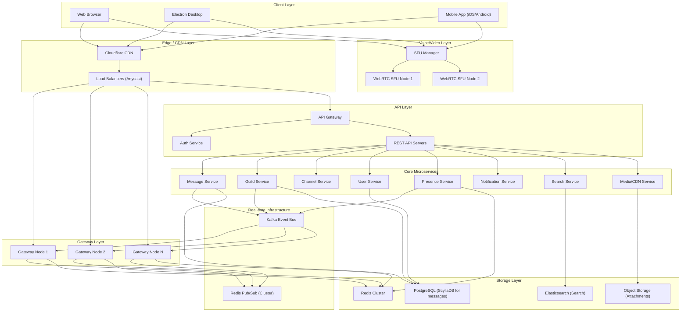
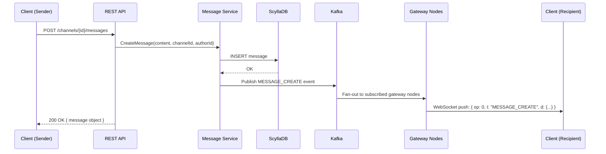

# Discord System Architecture (Inferred)

> This document describes Discord's inferred system architecture based on public engineering blog posts, job listings, conference talks, and observable network behavior. This is a best-effort reconstruction for educational purposes.

---

## High-Level Overview

Discord is a **microservices-based, event-driven platform** built for massive scale real-time communication. At its core, it separates:

1. **Gateway** — The stateful WebSocket layer that pushes events to clients
2. **API** — The stateless REST layer for CRUD operations
3. **Voice** — WebRTC-based media servers (Selective Forwarding Units)
4. **Services** — Dozens of specialized microservices for guilds, messages, presence, etc.

---

## System Architecture Diagram



---

## Microservices Breakdown

### 1. Gateway Service
- **Purpose**: Maintains persistent WebSocket connections with all clients
- **Tech**: Custom Erlang/Elixir service (later migrated to Rust for performance)
- **Scale**: Handles millions of concurrent WebSocket connections
- **Pattern**: Each gateway node maintains a session for connected clients; uses Redis pub/sub to receive events from other services and push them to relevant clients

### 2. API Service
- **Purpose**: Handles all REST HTTP requests
- **Tech**: Python (originally), Elixir/Go for high-throughput endpoints
- **Pattern**: Stateless, horizontally scalable. Routes requests to appropriate microservices.

### 3. Message Service
- **Purpose**: Store, retrieve, and fan-out messages
- **Storage**: Originally Cassandra, migrated to **ScyllaDB** for messages (chosen for time-series read patterns)
- **Pattern**: Write-heavy; messages are written to ScyllaDB then events published to Kafka

### 4. Guild Service
- **Purpose**: Manages server metadata, channels, roles, permissions
- **Storage**: PostgreSQL
- **Challenge**: Permission calculation for large servers (100k+ members)

### 5. Presence Service
- **Purpose**: Tracks online/idle/DND/offline status for all users
- **Storage**: Redis (purely in-memory, ephemeral)
- **Challenge**: Fan-out problem — when a user changes status, all friends/guild members must be notified
- **Solution**: Discord wrote a custom presence system; for large guilds, they use "lazy loading" (members presence is not sent for all members, only visible ones)

### 6. Voice Service
- **Purpose**: Route audio/video streams between participants
- **Tech**: WebRTC Selective Forwarding Units (SFUs)
- **Pattern**: Client connects to nearest SFU node; SFU forwards RTP streams between participants without decoding

### 7. Push Notification Service
- **Purpose**: Send push notifications to mobile devices
- **Tech**: Integrates with APNs (Apple) and FCM (Google)
- **Pattern**: Triggered by Kafka events; fans out to mobile-specific endpoints

---

## Data Flow: Sending a Message



---

## Real-time Communication Architecture

### WebSocket Gateway Protocol

Discord uses a custom binary/JSON WebSocket protocol called the **Discord Gateway**:

```
Client <──── WSS ────> Gateway Node
                           │
                       Session Store (Redis)
                           │
                       Event Router (Kafka/Redis Pub/Sub)
                           │
                       Microservices
```

**Key design decisions:**
- Clients connect to `wss://gateway.discord.gg`
- Gateway returns a `HELLO` opcode with heartbeat interval
- Clients send periodic `HEARTBEAT` to maintain connection
- On disconnect, session is preserved for ~90 seconds (resumable)
- Clients send `RESUME` with sequence number to replay missed events

### Lazy Loading for Large Guilds

For guilds with many members, Discord does **not** send the full member list on `GUILD_CREATE`. Instead:
- Members are sent in chunks: `GUILD_MEMBERS_CHUNK` events
- Presence is "lazy-loaded" — only visible members have their presence updated
- Client requests member data as users scroll the member list

---

## Scalability Patterns

### 1. Read Replicas
- PostgreSQL read replicas for guild metadata
- ScyllaDB multi-region replication for messages

### 2. Caching Strategy
- Redis L1 cache for hot data (sessions, presence, rate limits)
- CDN caching for static assets and avatars

### 3. Rate Limiting
- Token bucket algorithm at the API gateway
- Per-route, per-user, per-guild limits
- Implemented in Redis using sliding window counters

### 4. Database Sharding
- Messages sharded by channel ID (time-series access pattern)
- Users/Guilds sharded by ID range in PostgreSQL

### 5. Event Sourcing via Kafka
- All significant state changes published as events to Kafka
- Enables async processing, audit logs, and event replay
- Powers features like message search indexing

---

## Network Topology

Discord uses **Anycast** routing via Cloudflare to route clients to the nearest edge node. Gateway connections are established to regional endpoints:

| Region | Endpoint |
|--------|---------|
| US East | gateway.discord.gg (default) |
| US West | gateway-us-west.discord.gg |
| Europe | gateway-eu.discord.gg |
| Asia | gateway-asia.discord.gg |

Voice servers are selected based on RTT (Round Trip Time) measurements during connection establishment.

---

## Security Architecture

### Authentication
- **User tokens**: Long-lived tokens stored in client; refreshed periodically
- **Bot tokens**: Static tokens for bots; can be reset manually
- **OAuth2 Bearer tokens**: Short-lived, scoped tokens for third-party apps

### Transport Security
- All connections use TLS 1.3
- WebSocket connections use WSS (WebSocket Secure)
- Voice/Video uses SRTP (Secure Real-time Transport Protocol)
- DTLS for WebRTC signaling

### Permission System
- Role-based access control (RBAC) with channel-level overrides
- Permissions stored as 64-bit integers (bitfields)
- Computed at request time by layering guild-level and channel-level overrides

---

## Known Technology Choices (from public sources)

| Component | Technology | Source |
|-----------|-----------|--------|
| Message Store | ScyllaDB (originally Cassandra) | Discord Engineering Blog |
| Cache | Redis | Discord Engineering Blog |
| Event Bus | Kafka | Discord Engineering Blog |
| Voice Infra | Custom Rust services | Discord Engineering Blog |
| CDN | Cloudflare | Observable |
| Desktop App | Electron | Observable |
| Mobile | React Native | Job listings |
| API (legacy) | Python/Elixir | Early blog posts |
