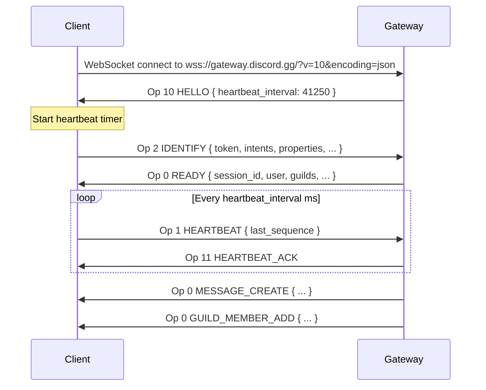
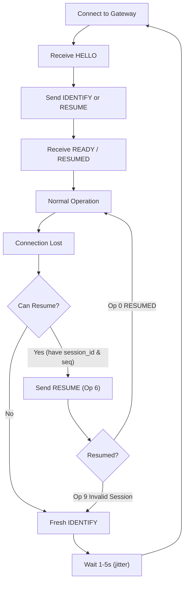

# 03 — Discord Gateway WebSocket Protocol

## Overview

The **Discord Gateway** is a WebSocket-based API that provides real-time event delivery. All client-to-server state changes (typing indicators, presence updates) and server-to-client events (new messages, member joins) flow through this connection.

```
Client  ←────── WSS ──────→  Gateway Node
        Real-time events       Stateful connection
        (JSON or ETF encoded)
```

**Gateway URL:** `wss://gateway.discord.gg/?v=10&encoding=json`

> You should always call `GET /gateway` or `GET /gateway/bot` first to get the optimal gateway URL for your connection.

---

## Connection Flow



---

## Opcodes

Discord uses numeric opcodes to identify message types:

| Opcode | Name | Direction | Description |
|--------|------|-----------|-------------|
| 0 | Dispatch | Server → Client | An event was dispatched |
| 1 | Heartbeat | Client → Server | Keepalive ping |
| 2 | Identify | Client → Server | Start a new session |
| 3 | Presence Update | Client → Server | Update presence/status |
| 4 | Voice State Update | Client → Server | Join/leave voice channel |
| 6 | Resume | Client → Server | Resume a disconnected session |
| 7 | Reconnect | Server → Client | Server wants client to reconnect |
| 8 | Request Guild Members | Client → Server | Request member list chunk |
| 9 | Invalid Session | Server → Client | Session invalid; must re-identify |
| 10 | Hello | Server → Client | First message after connecting |
| 11 | Heartbeat ACK | Server → Client | Heartbeat acknowledged |

---

## Message Structure

Every gateway message follows this structure:

```typescript
interface GatewayPayload {
  op: number;      // Opcode
  d: unknown;      // Data (varies by opcode)
  s: number | null; // Sequence number (null for non-dispatch messages)
  t: string | null;  // Event name (null for non-dispatch messages)
}
```

### Example Payloads

**HELLO (Op 10) — Server → Client:**
```json
{
  "op": 10,
  "d": {
    "heartbeat_interval": 41250
  },
  "s": null,
  "t": null
}
```

**IDENTIFY (Op 2) — Client → Server:**
```json
{
  "op": 2,
  "d": {
    "token": "Bot YOUR_BOT_TOKEN",
    "intents": 513,
    "properties": {
      "os": "linux",
      "browser": "my-discord-clone",
      "device": "my-discord-clone"
    },
    "compress": false,
    "large_threshold": 250,
    "presence": {
      "status": "online",
      "afk": false,
      "activities": [],
      "since": null
    }
  }
}
```

**HEARTBEAT (Op 1) — Client → Server:**
```json
{
  "op": 1,
  "d": 251  // Last received sequence number, or null if first heartbeat
}
```

---

## Heartbeat Mechanism

The heartbeat is critical for maintaining the connection. If the gateway doesn't receive a heartbeat within the interval, it will close the connection.

```typescript
class GatewayHeartbeat {
  private interval: NodeJS.Timeout | null = null;
  private lastSequence: number | null = null;
  private acknowledged = true;

  start(heartbeatInterval: number, ws: WebSocket) {
    // Add jitter to avoid thundering herd (all clients reconnecting at once)
    const jitter = Math.random() * heartbeatInterval;
    
    setTimeout(() => {
      this.send(ws);
      
      this.interval = setInterval(() => {
        if (!this.acknowledged) {
          // Zombie connection — gateway didn't ACK our last heartbeat
          ws.close(4000, 'Heartbeat not acknowledged');
          return;
        }
        this.acknowledged = false;
        this.send(ws);
      }, heartbeatInterval);
    }, jitter);
  }

  onAck() {
    this.acknowledged = true;
  }

  updateSequence(seq: number) {
    this.lastSequence = seq;
  }

  private send(ws: WebSocket) {
    ws.send(JSON.stringify({
      op: 1,
      d: this.lastSequence,
    }));
  }

  stop() {
    if (this.interval) {
      clearInterval(this.interval);
      this.interval = null;
    }
  }
}
```

---

## Reconnection Strategy

Discord connections can drop due to network issues. The correct reconnection strategy is:



### Close Codes

| Code | Description | Reconnect? |
|------|-------------|-----------|
| 4000 | Unknown error | ✅ Yes |
| 4001 | Unknown opcode | ✅ Yes |
| 4002 | Decode error | ✅ Yes |
| 4003 | Not authenticated | ❌ Identify again |
| 4004 | Authentication failed | ❌ No (bad token) |
| 4005 | Already authenticated | ✅ Yes |
| 4007 | Invalid seq | ✅ Yes (fresh IDENTIFY) |
| 4008 | Rate limited | ✅ Yes |
| 4009 | Session timed out | ✅ Yes (fresh IDENTIFY) |
| 4010 | Invalid shard | ❌ No |
| 4011 | Sharding required | ❌ No |
| 4012 | Invalid API version | ❌ No |
| 4013 | Invalid intent(s) | ❌ No |
| 4014 | Disallowed intent(s) | ❌ No |

---

## Resume Payload (Op 6)

```json
{
  "op": 6,
  "d": {
    "token": "Bot YOUR_BOT_TOKEN",
    "session_id": "SESSION_ID_FROM_READY_EVENT",
    "seq": 1337
  }
}
```

If successful, the gateway replays all missed events and sends `Op 0 RESUMED`. If not, it sends `Op 9 Invalid Session` and you must start fresh.

---

## Gateway Intents

**Intents** are a permission system that restricts which events you receive. This reduces bandwidth and processing.

```typescript
const GatewayIntents = {
  GUILDS:                    1 << 0,   // 1
  GUILD_MEMBERS:             1 << 1,   // 2  (Privileged)
  GUILD_MODERATION:          1 << 2,   // 4
  GUILD_EMOJIS_AND_STICKERS: 1 << 3,   // 8
  GUILD_INTEGRATIONS:        1 << 4,   // 16
  GUILD_WEBHOOKS:            1 << 5,   // 32
  GUILD_INVITES:             1 << 6,   // 64
  GUILD_VOICE_STATES:        1 << 7,   // 128
  GUILD_PRESENCES:           1 << 8,   // 256 (Privileged)
  GUILD_MESSAGES:            1 << 9,   // 512
  GUILD_MESSAGE_REACTIONS:   1 << 10,  // 1024
  GUILD_MESSAGE_TYPING:      1 << 11,  // 2048
  DIRECT_MESSAGES:           1 << 12,  // 4096
  DIRECT_MESSAGE_REACTIONS:  1 << 13,  // 8192
  DIRECT_MESSAGE_TYPING:     1 << 14,  // 16384
  MESSAGE_CONTENT:           1 << 15,  // 32768 (Privileged)
  GUILD_SCHEDULED_EVENTS:    1 << 16,  // 65536
  AUTO_MODERATION_CONFIG:    1 << 20,  // 1048576
  AUTO_MODERATION_EXECUTION: 1 << 21,  // 2097152
};

// Example: Listen for guild messages and DMs
const intents = GatewayIntents.GUILDS
  | GatewayIntents.GUILD_MESSAGES
  | GatewayIntents.GUILD_MESSAGE_REACTIONS
  | GatewayIntents.DIRECT_MESSAGES;
// = 1 | 512 | 1024 | 4096 = 5633
```

**Privileged intents** (GUILD_MEMBERS, GUILD_PRESENCES, MESSAGE_CONTENT) must be explicitly enabled in the Developer Portal for bots in 100+ servers.

---

## Events Reference

Events are delivered as `Op 0` Dispatch messages. The `t` field contains the event name.

### Session Events

#### `READY`
Sent after successful `IDENTIFY`.
```typescript
interface ReadyEvent {
  v: number;              // API version
  user: User;             // Current user object
  guilds: UnavailableGuild[]; // List of guilds (initially unavailable)
  session_id: string;     // Session ID for RESUME
  resume_gateway_url: string; // URL to use for RESUME
  shard?: [number, number]; // [shard_id, num_shards]
  application: {
    id: string;
    flags: number;
  };
}
```

#### `RESUMED`
Sent after successful `RESUME`. No data payload.

---

### Guild Events

#### `GUILD_CREATE`
Sent when joining a guild or when guilds become available after READY.
```typescript
interface GuildCreateEvent extends Guild {
  joined_at: string;
  large: boolean;
  unavailable?: boolean;
  member_count: number;
  voice_states: VoiceState[];
  members: GuildMember[];
  channels: Channel[];
  threads: Channel[];
  presences: PresenceUpdate[];
  stage_instances: StageInstance[];
  guild_scheduled_events: GuildScheduledEvent[];
}
```

#### `GUILD_UPDATE`
Guild was updated.

#### `GUILD_DELETE`
Left or was banned from a guild.

#### `GUILD_MEMBER_ADD`
A user joined a guild.
```json
{
  "t": "GUILD_MEMBER_ADD",
  "d": {
    "guild_id": "41771983423143937",
    "user": { "id": "...", "username": "..." },
    "roles": [],
    "joined_at": "2021-01-01T00:00:00.000Z",
    "deaf": false,
    "mute": false
  }
}
```

#### `GUILD_MEMBER_REMOVE`
A user left or was removed from a guild.

#### `GUILD_MEMBER_UPDATE`
A guild member was updated (roles, nickname, etc.).

#### `GUILD_MEMBERS_CHUNK`
Response to `Request Guild Members` (Op 8). Contains a chunk of guild members.

#### `GUILD_ROLE_CREATE` / `GUILD_ROLE_UPDATE` / `GUILD_ROLE_DELETE`
Role lifecycle events.

#### `GUILD_BAN_ADD` / `GUILD_BAN_REMOVE`
Ban events.

---

### Channel Events

#### `CHANNEL_CREATE` / `CHANNEL_UPDATE` / `CHANNEL_DELETE`
Channel lifecycle events.

#### `CHANNEL_PINS_UPDATE`
A channel's pinned messages changed.

---

### Message Events

#### `MESSAGE_CREATE`
A message was sent.
```typescript
interface MessageCreateEvent extends Message {
  guild_id?: string;      // Present for guild channels
  member?: GuildMember;   // Partial member data
  mentions: User[];       // Mentioned users with member data
}
```

#### `MESSAGE_UPDATE`
A message was edited. May contain only partial message data.

#### `MESSAGE_DELETE`
A message was deleted.
```json
{
  "t": "MESSAGE_DELETE",
  "d": {
    "id": "MESSAGE_ID",
    "channel_id": "CHANNEL_ID",
    "guild_id": "GUILD_ID"
  }
}
```

#### `MESSAGE_DELETE_BULK`
Multiple messages were deleted.

#### `MESSAGE_REACTION_ADD` / `MESSAGE_REACTION_REMOVE`
Reaction added/removed.

#### `MESSAGE_REACTION_REMOVE_ALL`
All reactions removed from a message.

#### `MESSAGE_REACTION_REMOVE_EMOJI`
All reactions of a specific emoji removed.

---

### Typing Events

#### `TYPING_START`
A user started typing.
```json
{
  "t": "TYPING_START",
  "d": {
    "channel_id": "CHANNEL_ID",
    "guild_id": "GUILD_ID",
    "user_id": "USER_ID",
    "timestamp": 1562384953,
    "member": {}
  }
}
```

---

### Presence Events

#### `PRESENCE_UPDATE`
A user's presence changed.
```typescript
interface PresenceUpdateEvent {
  user: { id: string };
  guild_id: string;
  status: 'online' | 'idle' | 'dnd' | 'offline';
  activities: Activity[];
  client_status: {
    desktop?: string;
    mobile?: string;
    web?: string;
  };
}
```

---

### Voice Events

#### `VOICE_STATE_UPDATE`
A user joined/left/moved a voice channel.
```typescript
interface VoiceStateUpdateEvent {
  guild_id?: string;
  channel_id: string | null;  // null = disconnected
  user_id: string;
  session_id: string;
  deaf: boolean;
  mute: boolean;
  self_deaf: boolean;
  self_mute: boolean;
  self_stream?: boolean;
  self_video: boolean;
  suppress: boolean;
  request_to_speak_timestamp: string | null;
}
```

#### `VOICE_SERVER_UPDATE`
Provides the voice server endpoint and token for establishing a voice WebRTC connection.
```json
{
  "t": "VOICE_SERVER_UPDATE",
  "d": {
    "token": "VOICE_TOKEN",
    "guild_id": "GUILD_ID",
    "endpoint": "us-east1-34567.discord.media"
  }
}
```

---

## Sending Presence Update (Op 3)

```json
{
  "op": 3,
  "d": {
    "since": null,
    "activities": [
      {
        "name": "Building a Discord Clone",
        "type": 0
      }
    ],
    "status": "online",
    "afk": false
  }
}
```

**Activity types:**
| Type | Name | Example |
|------|------|---------|
| 0 | Game | "Playing Minecraft" |
| 1 | Streaming | "Streaming on Twitch" |
| 2 | Listening | "Listening to Spotify" |
| 3 | Watching | "Watching YouTube" |
| 4 | Custom | "👾 Just chilling" |
| 5 | Competing | "Competing in a tournament" |

---

## Joining a Voice Channel (Op 4)

```json
{
  "op": 4,
  "d": {
    "guild_id": "GUILD_ID",
    "channel_id": "VOICE_CHANNEL_ID",
    "self_mute": false,
    "self_deaf": false
  }
}
```

After sending this:
1. You receive `VOICE_STATE_UPDATE` with your session_id
2. You receive `VOICE_SERVER_UPDATE` with the endpoint and token
3. Connect to the voice WebSocket with these credentials

---

## Requesting Guild Members (Op 8)

For large guilds, members are not sent with GUILD_CREATE. Request them:

```json
{
  "op": 8,
  "d": {
    "guild_id": "GUILD_ID",
    "query": "",
    "limit": 0
  }
}
```

You'll receive one or more `GUILD_MEMBERS_CHUNK` events.

---

## Compression

For high-volume applications, enable zlib stream compression:

```
wss://gateway.discord.gg/?v=10&encoding=json&compress=zlib-stream
```

All gateway messages (after HELLO) will be zlib-compressed. You need a persistent inflate context:

```typescript
import * as zlib from 'zlib';

const inflate = zlib.createInflate();
// Feed binary WebSocket data to inflate, get JSON out
```

## ETF (Erlang Term Format) Encoding

For even better performance, use ETF encoding:
```
wss://gateway.discord.gg/?v=10&encoding=etf
```

ETF is binary Erlang term format — more compact than JSON. You'll need an ETF decoder library.

---

## Full Client Implementation Example

```typescript
import WebSocket from 'ws';
import { EventEmitter } from 'events';

const GatewayOpcodes = {
  Dispatch: 0,
  Heartbeat: 1,
  Identify: 2,
  PresenceUpdate: 3,
  VoiceStateUpdate: 4,
  Resume: 6,
  Reconnect: 7,
  RequestGuildMembers: 8,
  InvalidSession: 9,
  Hello: 10,
  HeartbeatAck: 11,
} as const;

class DiscordGatewayClient extends EventEmitter {
  private ws: WebSocket | null = null;
  private heartbeatInterval: NodeJS.Timeout | null = null;
  private lastSequence: number | null = null;
  private sessionId: string | null = null;
  private resumeUrl: string | null = null;
  private heartbeatAcked = true;

  constructor(private token: string, private intents: number) {
    super();
  }

  connect(url = 'wss://gateway.discord.gg/?v=10&encoding=json') {
    this.ws = new WebSocket(url);

    this.ws.on('message', (data: string) => {
      const payload = JSON.parse(data);
      this.handlePayload(payload);
    });

    this.ws.on('close', (code: number) => {
      this.handleClose(code);
    });

    this.ws.on('error', (err: Error) => {
      this.emit('error', err);
    });
  }

  private handlePayload(payload: any) {
    if (payload.s) this.lastSequence = payload.s;

    switch (payload.op) {
      case GatewayOpcodes.Hello:
        this.startHeartbeat(payload.d.heartbeat_interval);
        if (this.sessionId) {
          this.resume();
        } else {
          this.identify();
        }
        break;

      case GatewayOpcodes.HeartbeatAck:
        this.heartbeatAcked = true;
        break;

      case GatewayOpcodes.Heartbeat:
        this.sendHeartbeat();
        break;

      case GatewayOpcodes.Reconnect:
        this.ws?.close();
        break;

      case GatewayOpcodes.InvalidSession:
        const resumable = payload.d;
        setTimeout(() => {
          if (resumable) {
            this.resume();
          } else {
            this.sessionId = null;
            this.identify();
          }
        }, Math.random() * 4000 + 1000);
        break;

      case GatewayOpcodes.Dispatch:
        this.handleDispatch(payload.t, payload.d);
        break;
    }
  }

  private handleDispatch(event: string, data: any) {
    if (event === 'READY') {
      this.sessionId = data.session_id;
      this.resumeUrl = data.resume_gateway_url;
    }
    this.emit(event, data);
    this.emit('dispatch', event, data);
  }

  private identify() {
    this.send({
      op: GatewayOpcodes.Identify,
      d: {
        token: this.token,
        intents: this.intents,
        properties: {
          os: process.platform,
          browser: 'discord-clone',
          device: 'discord-clone',
        },
        large_threshold: 250,
      },
    });
  }

  private resume() {
    this.send({
      op: GatewayOpcodes.Resume,
      d: {
        token: this.token,
        session_id: this.sessionId,
        seq: this.lastSequence,
      },
    });
  }

  private startHeartbeat(interval: number) {
    // Add jitter
    const jitter = Math.random() * interval;
    setTimeout(() => {
      this.sendHeartbeat();
      this.heartbeatInterval = setInterval(() => {
        if (!this.heartbeatAcked) {
          this.ws?.close(4000, 'Heartbeat not acked');
          return;
        }
        this.heartbeatAcked = false;
        this.sendHeartbeat();
      }, interval);
    }, jitter);
  }

  private sendHeartbeat() {
    this.send({ op: GatewayOpcodes.Heartbeat, d: this.lastSequence });
  }

  private send(payload: any) {
    if (this.ws?.readyState === WebSocket.OPEN) {
      this.ws.send(JSON.stringify(payload));
    }
  }

  private handleClose(code: number) {
    if (this.heartbeatInterval) {
      clearInterval(this.heartbeatInterval);
    }

    const reconnectCodes = [4000, 4001, 4002, 4005, 4007, 4008, 4009];
    if (reconnectCodes.includes(code)) {
      const url = this.resumeUrl || 'wss://gateway.discord.gg/?v=10&encoding=json';
      setTimeout(() => this.connect(url), 1000 + Math.random() * 4000);
    }
  }
}

// Usage
const client = new DiscordGatewayClient('Bot TOKEN', 513);
client.on('READY', (data) => console.log('Connected as', data.user.username));
client.on('MESSAGE_CREATE', (msg) => console.log('New message:', msg.content));
client.connect();
```
