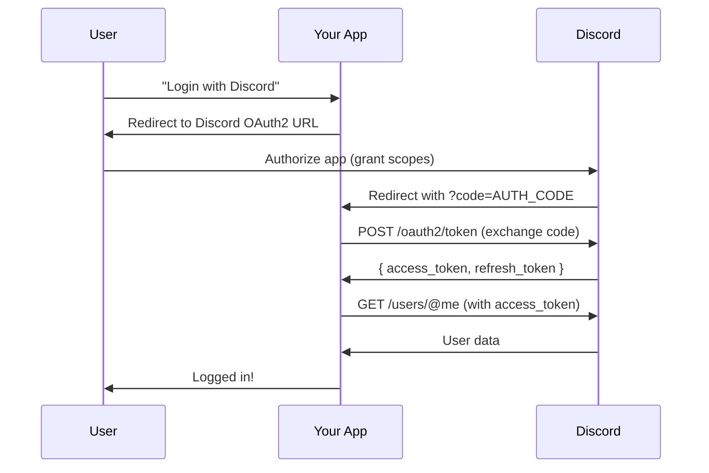
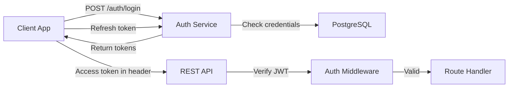

# 04 — Discord Authentication Flow

## Overview

Discord uses several authentication mechanisms:
1. **User login** — Email/password → User token
2. **OAuth2** — Third-party app authorization
3. **Bot tokens** — Server-to-server authentication
4. **MFA (2FA)** — TOTP-based multi-factor authentication

---

## Token Types

| Type | Format | Used By | Lifetime |
|------|--------|---------|----------|
| Bot token | `Bot BASE64.HMAC` | Bots | Permanent (until reset) |
| User token | `BASE64.TIMESTAMP.HMAC` | Official clients | Long-lived |
| Bearer token | Random string | OAuth2 apps | 7 days (default) |
| Refresh token | Random string | OAuth2 apps | 30 days |

### Token Anatomy (User Token)

Discord user tokens follow this structure:
```
BASE64(user_id).TIMESTAMP.HMAC_SIGNATURE
```

Example:
```
NOME_DO_USUARIO_BASE64.TIMESTAMP_FALSO.ASSINATURA_HMAC_FALSA_AQUI
 └── user_id (b64) ──┘  └─ts─┘└──── HMAC signature ───────────┘
```

> ⚠️ **Never share your user token.** Anyone with your token has full access to your account.

---

## OAuth2 Flow

The OAuth2 Authorization Code flow is used for third-party applications:



### Step 1: Build the Authorization URL

```typescript
interface OAuth2Config {
  clientId: string;
  redirectUri: string;
  scopes: string[];
  state?: string;  // CSRF protection
}

function buildOAuth2Url(config: OAuth2Config): string {
  const params = new URLSearchParams({
    client_id: config.clientId,
    redirect_uri: config.redirectUri,
    response_type: 'code',
    scope: config.scopes.join(' '),
    state: config.state || crypto.randomUUID(),
  });
  
  return `https://discord.com/oauth2/authorize?${params.toString()}`;
}

// Example
const authUrl = buildOAuth2Url({
  clientId: '1234567890',
  redirectUri: 'https://my-app.com/auth/callback',
  scopes: ['identify', 'email', 'guilds'],
});
```

### Available OAuth2 Scopes

| Scope | Description |
|-------|-------------|
| `identify` | Read username, discriminator, avatar |
| `email` | Read email address |
| `guilds` | List guilds user is in |
| `guilds.join` | Add user to a guild |
| `guilds.members.read` | Read guild member info |
| `gdm.join` | Add user to a group DM |
| `messages.read` | Read messages (requires approval) |
| `webhook.incoming` | Create webhooks |
| `bot` | Add bot to guild (use with `permissions`) |
| `applications.commands` | Register slash commands |
| `role_connections.write` | Update role connection metadata |

### Step 2: Exchange Authorization Code for Token

```typescript
interface TokenResponse {
  access_token: string;
  token_type: 'Bearer';
  expires_in: number;        // seconds
  refresh_token: string;
  scope: string;
}

async function exchangeCode(
  code: string,
  config: { clientId: string; clientSecret: string; redirectUri: string }
): Promise<TokenResponse> {
  const response = await fetch('https://discord.com/api/v10/oauth2/token', {
    method: 'POST',
    headers: {
      'Content-Type': 'application/x-www-form-urlencoded',
    },
    body: new URLSearchParams({
      client_id: config.clientId,
      client_secret: config.clientSecret,
      grant_type: 'authorization_code',
      code,
      redirect_uri: config.redirectUri,
    }),
  });
  
  if (!response.ok) {
    const error = await response.json();
    throw new Error(`OAuth2 error: ${error.error_description}`);
  }
  
  return response.json();
}
```

### Step 3: Get User Information

```typescript
async function getCurrentUser(accessToken: string) {
  const response = await fetch('https://discord.com/api/v10/users/@me', {
    headers: {
      Authorization: `Bearer ${accessToken}`,
    },
  });
  return response.json();
}
```

### Step 4: Refresh the Token

Access tokens expire after 7 days. Use the refresh token to get a new one:

```typescript
async function refreshToken(
  refreshToken: string,
  config: { clientId: string; clientSecret: string }
): Promise<TokenResponse> {
  const response = await fetch('https://discord.com/api/v10/oauth2/token', {
    method: 'POST',
    headers: {
      'Content-Type': 'application/x-www-form-urlencoded',
    },
    body: new URLSearchParams({
      client_id: config.clientId,
      client_secret: config.clientSecret,
      grant_type: 'refresh_token',
      refresh_token: refreshToken,
    }),
  });
  return response.json();
}
```

### Step 5: Revoke Token

```typescript
async function revokeToken(token: string, config: { clientId: string; clientSecret: string }) {
  await fetch('https://discord.com/api/v10/oauth2/token/revoke', {
    method: 'POST',
    headers: {
      'Content-Type': 'application/x-www-form-urlencoded',
      'Authorization': `Basic ${Buffer.from(`${config.clientId}:${config.clientSecret}`).toString('base64')}`,
    },
    body: new URLSearchParams({ token }),
  });
}
```

---

## Bot Authentication

Bots use a simpler authentication model — a static secret token:

```typescript
// All requests include this header:
headers: {
  'Authorization': `Bot ${process.env.DISCORD_BOT_TOKEN}`,
  'Content-Type': 'application/json',
  'User-Agent': 'DiscordBot (https://github.com/my/bot, 1.0.0)',
}
```

Bot tokens are obtained from the Discord Developer Portal:
1. Go to https://discord.com/developers/applications
2. Select your application
3. Go to "Bot" section
4. Click "Reset Token" (and copy immediately)

---

## Implementing Auth for Your Clone

Your Discord clone needs its own authentication system. Here's a recommended JWT-based implementation:

### Architecture



### Database Schema

```sql
CREATE TABLE users (
  id          BIGINT PRIMARY KEY,       -- Snowflake ID
  email       VARCHAR(255) UNIQUE NOT NULL,
  username    VARCHAR(32) NOT NULL,
  discriminator VARCHAR(4) NOT NULL DEFAULT '0000',
  password_hash VARCHAR(255) NOT NULL,  -- bcrypt hash
  avatar      VARCHAR(255),
  created_at  TIMESTAMP WITH TIME ZONE DEFAULT NOW(),
  verified    BOOLEAN DEFAULT FALSE,
  mfa_enabled BOOLEAN DEFAULT FALSE,
  mfa_secret  VARCHAR(255),            -- TOTP secret (encrypted)
  UNIQUE(username, discriminator)
);

CREATE TABLE refresh_tokens (
  id          UUID PRIMARY KEY DEFAULT gen_random_uuid(),
  user_id     BIGINT REFERENCES users(id) ON DELETE CASCADE,
  token_hash  VARCHAR(255) NOT NULL,  -- Hash of the refresh token
  expires_at  TIMESTAMP WITH TIME ZONE NOT NULL,
  created_at  TIMESTAMP WITH TIME ZONE DEFAULT NOW(),
  revoked     BOOLEAN DEFAULT FALSE,
  device_info VARCHAR(255)             -- Optional: browser/device info
);
```

### Snowflake ID Generation

Discord uses Twitter Snowflake IDs — 64-bit integers encoding time + machine ID + sequence.

```typescript
// Snowflake epoch: Discord uses January 1, 2015
const DISCORD_EPOCH = 1420070400000n;

class Snowflake {
  private static increment = 0n;
  private static workerId = 0n;  // Set per machine/process
  
  static generate(): bigint {
    const timestamp = BigInt(Date.now()) - DISCORD_EPOCH;
    const sequence = Snowflake.increment++ & 0xFFFn; // 12 bits
    
    return (timestamp << 22n)
      | (Snowflake.workerId << 17n)
      | sequence;
  }
  
  static extractTimestamp(snowflake: bigint): Date {
    const timestamp = (snowflake >> 22n) + DISCORD_EPOCH;
    return new Date(Number(timestamp));
  }
}
```

### Auth Service (NestJS)

```typescript
import { Injectable, UnauthorizedException, ConflictException } from '@nestjs/common';
import { JwtService } from '@nestjs/jwt';
import { InjectRepository } from '@nestjs/typeorm';
import * as bcrypt from 'bcrypt';
import { Repository } from 'typeorm';

@Injectable()
export class AuthService {
  constructor(
    @InjectRepository(User)
    private usersRepo: Repository<User>,
    @InjectRepository(RefreshToken)
    private refreshTokensRepo: Repository<RefreshToken>,
    private jwtService: JwtService,
  ) {}

  async register(dto: RegisterDto) {
    const existing = await this.usersRepo.findOne({
      where: { email: dto.email }
    });
    
    if (existing) {
      throw new ConflictException('Email already registered');
    }

    const passwordHash = await bcrypt.hash(dto.password, 12);
    
    const user = this.usersRepo.create({
      id: Snowflake.generate(),
      email: dto.email,
      username: dto.username,
      discriminator: await this.generateDiscriminator(dto.username),
      passwordHash,
    });
    
    await this.usersRepo.save(user);
    return this.generateTokens(user);
  }

  async login(dto: LoginDto) {
    const user = await this.usersRepo.findOne({
      where: { email: dto.email }
    });
    
    if (!user || !await bcrypt.compare(dto.password, user.passwordHash)) {
      throw new UnauthorizedException('Invalid credentials');
    }
    
    if (user.mfaEnabled) {
      // Return partial token that only allows MFA verification
      return { mfa_required: true, ticket: this.generateMfaTicket(user) };
    }
    
    return this.generateTokens(user);
  }

  async generateTokens(user: User) {
    const payload = { sub: user.id.toString(), email: user.email };
    
    const accessToken = this.jwtService.sign(payload, {
      expiresIn: '15m',  // Short-lived access token
    });
    
    const refreshToken = crypto.randomUUID();
    const refreshTokenHash = await bcrypt.hash(refreshToken, 10);
    
    await this.refreshTokensRepo.save({
      userId: user.id,
      tokenHash: refreshTokenHash,
      expiresAt: new Date(Date.now() + 30 * 24 * 60 * 60 * 1000), // 30 days
    });
    
    return {
      access_token: accessToken,
      refresh_token: refreshToken,
      token_type: 'Bearer',
      expires_in: 900, // 15 minutes
    };
  }

  async refresh(refreshTokenValue: string) {
    // Find valid refresh tokens for this user
    // This is simplified — in production, you'd include the user ID
    const tokens = await this.refreshTokensRepo.find({
      where: { revoked: false },
      relations: ['user'],
    });
    
    for (const token of tokens) {
      if (await bcrypt.compare(refreshTokenValue, token.tokenHash)) {
        if (token.expiresAt < new Date()) {
          throw new UnauthorizedException('Refresh token expired');
        }
        // Rotate refresh token
        await this.refreshTokensRepo.update(token.id, { revoked: true });
        return this.generateTokens(token.user);
      }
    }
    
    throw new UnauthorizedException('Invalid refresh token');
  }
  
  private async generateDiscriminator(username: string): Promise<string> {
    // Check existing discriminators for this username
    const existing = await this.usersRepo.find({ where: { username } });
    const used = new Set(existing.map(u => u.discriminator));
    
    // Find an unused one
    for (let i = 1; i <= 9999; i++) {
      const disc = i.toString().padStart(4, '0');
      if (!used.has(disc)) return disc;
    }
    
    throw new ConflictException('Username is taken');
  }
}
```

### JWT Strategy

```typescript
import { Injectable } from '@nestjs/common';
import { PassportStrategy } from '@nestjs/passport';
import { ExtractJwt, Strategy } from 'passport-jwt';

@Injectable()
export class JwtStrategy extends PassportStrategy(Strategy) {
  constructor() {
    super({
      jwtFromRequest: ExtractJwt.fromAuthHeaderAsBearerToken(),
      ignoreExpiration: false,
      secretOrKey: process.env.JWT_SECRET,
    });
  }

  async validate(payload: { sub: string; email: string }) {
    return { id: payload.sub, email: payload.email };
  }
}
```

---

## Multi-Factor Authentication (MFA/2FA)

Discord supports TOTP (Time-based One-Time Password) using apps like Google Authenticator.

```typescript
import { authenticator } from 'otplib';
import * as QRCode from 'qrcode';

// Generate MFA secret and QR code
async function setupMfa(user: User) {
  const secret = authenticator.generateSecret();
  const otpauthUrl = authenticator.keyuri(user.email, 'DiscordClone', secret);
  const qrCodeDataUrl = await QRCode.toDataURL(otpauthUrl);
  
  return {
    secret,           // Store encrypted in DB
    qrCode: qrCodeDataUrl,
    backupCodes: generateBackupCodes(),
  };
}

// Verify MFA code
function verifyMfa(token: string, secret: string): boolean {
  return authenticator.check(token, secret);
}

function generateBackupCodes(): string[] {
  return Array.from({ length: 10 }, () =>
    crypto.randomBytes(5).toString('hex').toUpperCase()
      .match(/.{1,5}/g)!.join('-')
  );
}
```

---

## Security Best Practices for Your Clone

### Password Storage
```typescript
// Always use bcrypt with high cost factor
const BCRYPT_ROUNDS = 12; // ~300ms on modern hardware
const hash = await bcrypt.hash(password, BCRYPT_ROUNDS);
```

### Rate Limiting Login Attempts
```typescript
// Use Redis to track failed attempts
const key = `login_attempts:${ip}:${email}`;
const attempts = await redis.incr(key);
await redis.expire(key, 300); // 5 minute window

if (attempts > 5) {
  throw new TooManyRequestsException('Too many login attempts');
}
```

### CSRF Protection
```typescript
// For web apps: use SameSite cookies + CSRF tokens
// For SPAs with Bearer tokens: CSRF is not needed (tokens in Authorization header)
```

### Secure Token Storage (Client-side)
```typescript
// ❌ Bad: localStorage (vulnerable to XSS)
localStorage.setItem('token', accessToken);

// ✅ Better: HttpOnly cookie (protected from XSS)
// Server sets: Set-Cookie: access_token=...; HttpOnly; Secure; SameSite=Strict

// ✅ For desktop/mobile apps: OS keychain
// Use electron-store with encryption, or OS credential store
```
