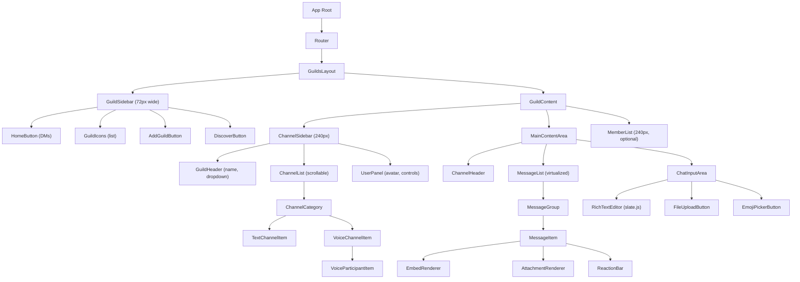

# 05 — Discord UI Structure & Component Analysis

## Overview

Discord's UI is a sophisticated React application with a consistent design system. The interface can be broken down into distinct zones that remain persistent across navigation, with the main content area changing based on the selected context.

---

## High-Level Layout

```
┌────────────────────────────────────────────────────────────────────────┐
│                           Discord App Window                           │
│ ┌────┐ ┌───────────────┐ ┌──────────────────────────────┐ ┌─────────┐ │
│ │    │ │               │ │                              │ │         │ │
│ │ G  │ │   Channel     │ │        Main Content          │ │ Member  │ │
│ │ u  │ │   Sidebar     │ │          Area                │ │  List   │ │
│ │ i  │ │               │ │                              │ │         │ │
│ │ l  │ │  #general     │ │  ╔══════════════════════╗   │ │ Online  │ │
│ │ d  │ │  #random      │ │  ║  Message History     ║   │ │ ───     │ │
│ │    │ │  #voice       │ │  ╠══════════════════════╣   │ │ User 1  │ │
│ │ S  │ │               │ │  ║  Message Input       ║   │ │ User 2  │ │
│ │ i  │ │  Categories   │ │  ╚══════════════════════╝   │ │         │ │
│ │ d  │ │  ───────────  │ │                              │ │ Offline │ │
│ │ e  │ │  #dev-chat    │ │                              │ │ ───     │ │
│ │ b  │ │  #help        │ │                              │ │ User 3  │ │
│ │ a  │ │               │ │                              │ │         │ │
│ │ r  │ │  🔊 VC Lobby  │ │                              │ │         │ │
│ │    │ │               │ │                              │ │         │ │
│ │    │ ├───────────────┤ └──────────────────────────────┘ └─────────┘ │
│ │    │ │  User Panel   │                                               │
│ └────┘ └───────────────┘                                               │
└────────────────────────────────────────────────────────────────────────┘
```

---

## Component Hierarchy



---

## Zone 1: Guild Sidebar (72px)

The leftmost strip showing guild (server) icons.

```typescript
interface GuildSidebarProps {
  guilds: Guild[];
  selectedGuildId: string | null;
  unreadGuildIds: Set<string>;
  mentionCounts: Map<string, number>;
}

// Key behaviors:
// - Shows home button (compass) at top for DM view
// - Each guild shows icon or initials
// - Unread indicator: dot on the left edge
// - Mention indicator: red badge with count
// - Right-click: context menu (mark as read, leave server, etc.)
// - Drag to reorder (react-beautiful-dnd)
// - Plus button at bottom to add/create server
// - Discover button (compass) for public servers
```

**Visual Details:**
- Guild icon: 48px circle, hover expands to squircle (rounded rect)
- Active guild: white pill/indicator on the left edge
- Unread guild: smaller white dot + darker icon
- Context menu on right-click with: Mark As Read, Invite People, Hide Muted Channels, Notification Settings, Privacy Settings, Edit Server Profile, Leave Server

---

## Zone 2: Channel Sidebar (240px)

Shows channels within the selected guild or DM list.

```typescript
interface ChannelSidebarProps {
  guild: Guild;
  channels: Channel[];
  voiceStates: Map<string, VoiceState[]>;
  currentUser: User;
}
```

**Guild Header (top):**
- Shows server name
- Dropdown arrow → opens guild menu
- Menu items: Invite People, Server Settings, Create Channel, Create Category, etc.
- Server boost bar (if boosted)
- Nitro boost "Server Boost" CTA if not boosted

**Channel Categories:**
- Collapsible with triangle arrow
- Channels sorted by position within category
- "+" button on hover to create channel in category

**Text Channel Item:**
```typescript
interface TextChannelItemProps {
  channel: Channel;
  unreadCount: number;
  mentionCount: number;
  isSelected: boolean;
  hasUnseen: boolean;  // Shows bold name + white dot
}
// Channel icon: # for text, 🔊 for voice, 📢 for announcements
// Hover: shows Edit (pencil) + AddMember (person+) icons
// Context menu: Mark As Read, Invite People, Edit Channel, etc.
```

**Voice Channel Item:**
- Shows connected members below the channel
- Each participant: avatar, username, speaking indicator (green ring), mute/deaf icons

**User Panel (bottom of channel sidebar):**
```typescript
interface UserPanelProps {
  currentUser: User;
  voiceState: VoiceState | null;
  settings: UserSettings;
}

// Shows:
// - User avatar (40px) with status indicator
// - Username + discriminator
// - Mute button (microphone)
// - Deafen button (headphones)
// - Settings button (gear icon)
// When in voice: shows voice channel name and "disconnect" button
```

---

## Zone 3: Main Content Area

The central, scrollable content region.

### Channel Header

```typescript
interface ChannelHeaderProps {
  channel: Channel;
  memberCount?: number;
  pinnedMessagesCount?: number;
  isThreadsOpen?: boolean;
}

// Elements:
// - Channel icon + name (bold)
// - Channel topic (truncated, click to expand)
// - Right toolbar: Thread, Notification, Pinned, Member List, Search, Inbox, Help
```

### Message List (Virtualized)

Discord uses virtualized scrolling for performance — only renders visible messages.

```typescript
interface MessageListProps {
  channelId: string;
  messages: Message[];
  hasMoreAbove: boolean;
  hasMoreBelow: boolean;
  onScrollToTop: () => void;  // Load older messages
}

// Message grouping rules:
// Messages from the same user within 7 minutes are grouped:
// - First message: shows avatar + username + timestamp
// - Subsequent messages in group: no avatar, timestamp only on hover
// - System messages (joins, boosts) have their own style
```

### Message Item

```typescript
interface MessageItemProps {
  message: Message;
  isGrouped: boolean;    // Is this a continuation of a previous message?
  isHighlighted: boolean; // Is this message referenced/jumped to?
  currentUserId: string;
}
```

**Message Context Menu (right-click):**
- Add Reaction
- Edit Message (own messages)
- Pin Message (requires permissions)
- Reply
- Create Thread
- Mark Unread
- Copy Message Link
- Delete Message (own or with permission)

### Rich Text Editor

Discord uses a custom rich text editor (similar to Slate.js) with support for:

```typescript
// Markdown shortcuts (auto-converted while typing):
// **text** → bold
// *text* or _text_ → italic
// __text__ → underline
// ~~text~~ → strikethrough
// `code` → inline code
// ```lang\ncode\n``` → code block
// > text → blockquote
// ||text|| → spoiler

interface EditorState {
  content: string;         // Raw markdown
  richContent: SlateNode[]; // Parsed rich content
  attachments: File[];
  replyTo: Message | null;
}
```

---

## Zone 4: Member List (240px, toggleable)

Shows guild members organized by role.

```typescript
interface MemberListProps {
  guildId: string;
  channelId: string;
  members: GuildMember[];
  presences: Map<string, Presence>;
}

// Organization:
// - Sections by hoisted role (roles with hoist: true)
// - "ONLINE — X" header per section
// - "OFFLINE — X" section at bottom (collapsed by default)
// - Each member: avatar (32px) + status dot + display name + role color
// - Right-click: Message, Mention, View Profile, Kick, Ban, etc.
// - Click: opens profile popup (mini-profile)
```

---

## Popups & Overlays

### User Profile Popup

```typescript
interface UserProfilePopupProps {
  user: User;
  guildMember?: GuildMember;
  position: { x: number; y: number };
}

// Contains:
// - Banner (gradient or custom image)
// - Avatar (80px, overlapping banner)
// - Username + pronouns
// - Custom status/activity
// - "About Me" section
// - Member Since / Server Member Since
// - Roles badges
// - Mutual servers / mutual friends
// - Action buttons: Message, Video Call, More
```

### Context Menu

Discord's context menus are positioned dynamically to avoid viewport overflow:

```typescript
interface ContextMenuProps {
  items: ContextMenuItem[];
  position: { x: number; y: number };
  onClose: () => void;
}

type ContextMenuItem =
  | { type: 'item'; label: string; icon?: string; action: () => void; danger?: boolean; disabled?: boolean }
  | { type: 'separator' }
  | { type: 'submenu'; label: string; items: ContextMenuItem[] };
```

---

## Design System

### Colors (Dark Theme)

```css
:root {
  /* Backgrounds */
  --background-primary: #313338;      /* Main chat area */
  --background-secondary: #2b2d31;    /* Sidebar */
  --background-tertiary: #1e1f22;     /* Guild sidebar */
  --background-accent: #4e5058;       /* Hover states */
  
  /* Text */
  --text-normal: #dbdee1;
  --text-muted: #80848e;
  --text-link: #00a8fc;
  
  /* Interactive */
  --interactive-normal: #b5bac1;
  --interactive-hover: #dbdee1;
  --interactive-active: #ffffff;
  --interactive-muted: #41434a;
  
  /* Status */
  --status-online: #23a559;
  --status-idle: #f0b232;
  --status-dnd: #f23f43;
  --status-invisible: #80848e;
  
  /* Brand */
  --brand-500: #5865f2;              /* Blurple */
  --brand-600: #4752c4;             /* Hover */
  
  /* Danger */
  --red-500: #f23f43;
  
  /* Success */
  --green-360: #23a559;
}
```

### Typography

```css
/* Discord uses Whitney (custom font), falls back to system fonts */
font-family: 'gg sans', 'Noto Sans', 'Helvetica Neue', Helvetica, Arial, sans-serif;

/* Text sizes */
--font-size-xs: 10px;
--font-size-sm: 12px;
--font-size-md: 14px;    /* Body text */
--font-size-lg: 16px;
--font-size-xl: 20px;

/* Channel name */
font-size: 16px;
font-weight: 600;
```

### Spacing

```css
/* Discord uses a 4px base unit */
--spacing-1: 4px;
--spacing-2: 8px;
--spacing-3: 12px;
--spacing-4: 16px;
--spacing-6: 24px;
--spacing-8: 32px;
```

---

## State Management Patterns

Discord's frontend uses a Flux-like unidirectional data flow. For your clone, here's a recommended Zustand state structure:

```typescript
// auth-store.ts
interface AuthState {
  user: User | null;
  token: string | null;
  login: (email: string, password: string) => Promise<void>;
  logout: () => void;
}

// guild-store.ts
interface GuildState {
  guilds: Map<string, Guild>;
  guildOrder: string[];
  selectedGuildId: string | null;
  setSelectedGuild: (id: string) => void;
}

// channel-store.ts
interface ChannelState {
  channels: Map<string, Channel>;
  selectedChannelId: string | null;
  setSelectedChannel: (id: string) => void;
}

// message-store.ts
interface MessageState {
  messages: Map<string, Message[]>;  // channelId → messages
  loadMessages: (channelId: string, before?: string) => Promise<void>;
  addMessage: (message: Message) => void;
  updateMessage: (message: Message) => void;
  deleteMessage: (channelId: string, messageId: string) => void;
}

// presence-store.ts
interface PresenceState {
  presences: Map<string, Presence>;  // userId → presence
  updatePresence: (userId: string, presence: Presence) => void;
}

// voice-store.ts
interface VoiceState {
  currentChannelId: string | null;
  isMuted: boolean;
  isDeafened: boolean;
  participants: Map<string, VoiceParticipant>;
  join: (channelId: string) => Promise<void>;
  leave: () => void;
  toggleMute: () => void;
  toggleDeafen: () => void;
}
```

---

## Performance Optimizations to Note

1. **Message virtualization**: Discord uses a custom virtual scroll — only ~50 messages are in the DOM at any time. When scrolling, old messages are unmounted.

2. **Lazy member list**: The member list only renders members currently in the viewport.

3. **Image lazy loading**: Attachments and avatars use `IntersectionObserver` to load only when visible.

4. **Memoization**: Message components use `React.memo` aggressively to prevent re-renders on unrelated state changes.

5. **Batched Gateway events**: Multiple gateway events that arrive close together are batched and processed in a single React state update.

6. **Debounced typing**: The typing indicator is debounced — it only sends `POST /typing` once per 8 seconds while the user is actively typing.
