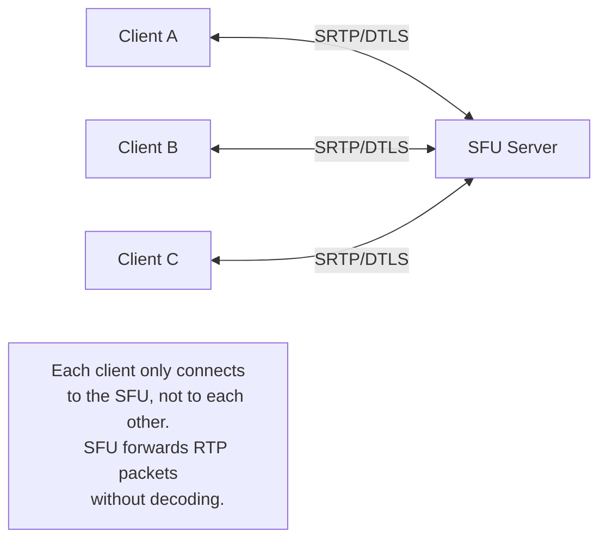
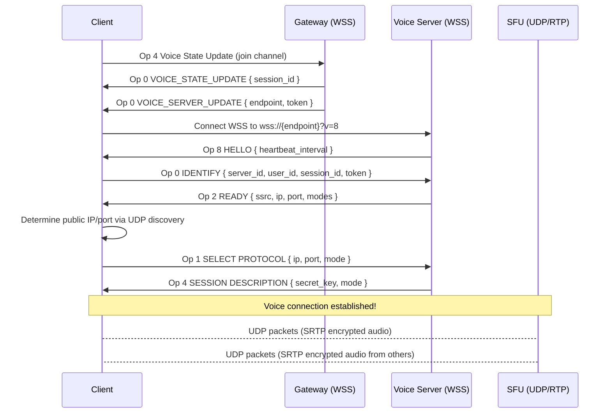

# 06 — Voice & Video: WebRTC Architecture

## Overview

Discord's voice and video system is one of its most impressive technical achievements. It uses **WebRTC** (Web Real-Time Communication) with a **Selective Forwarding Unit (SFU)** architecture to handle voice calls with hundreds of concurrent participants.

---

## WebRTC Fundamentals

**WebRTC** is a browser/runtime API for real-time peer-to-peer (P2P) audio, video, and data communication. It handles:
- **Audio/Video capture** via `getUserMedia()`
- **Codec negotiation** (SDP offer/answer)
- **NAT traversal** via ICE (Interactive Connectivity Establishment)
- **Encrypted transport** via SRTP and DTLS



---

## P2P vs SFU vs MCU

| Architecture | How It Works | Pros | Cons |
|-------------|-------------|------|------|
| **P2P (Mesh)** | Each participant connects to every other | Simple, low latency | O(n²) bandwidth, bad at scale |
| **SFU** | All connect to central server; server forwards RTP | Scalable, server saves bandwidth | Server cost, slight latency |
| **MCU** | Server decodes and re-encodes all streams | Best for recording/transcoding | High server CPU, more latency |

**Discord uses SFU** — the server receives RTP streams and forwards them to other participants without decoding (no CPU-heavy re-encoding).

---

## Discord Voice Connection Flow



---

## Voice WebSocket Opcodes

| Opcode | Name | Direction | Description |
|--------|------|-----------|-------------|
| 0 | Identify | Client → Server | Authenticate |
| 1 | Select Protocol | Client → Server | Provide IP/port/encryption mode |
| 2 | Ready | Server → Client | SSRC, server IP/port |
| 3 | Heartbeat | Client → Server | Keepalive |
| 4 | Session Description | Server → Client | Encryption key, mode |
| 5 | Speaking | Bidirectional | Signal speaking state (SSRC mapping) |
| 6 | Heartbeat ACK | Server → Client | Heartbeat acknowledged |
| 7 | Resume | Client → Server | Resume dropped connection |
| 8 | Hello | Server → Client | Heartbeat interval |
| 9 | Resumed | Server → Client | Resume acknowledged |
| 12 | Client Disconnect | Server → Client | A client disconnected |
| 13 | Video | Bidirectional | Video stream information |
| 18 | Media Sink Wants | Server → Client | Bitrate/quality request |
| 20 | Voice Backend Version | Server → Client | Server backend info |
| 21 | Channel Options Update | Server → Client | Channel configuration |

---

## IP Discovery (NAT Hole Punching)

After receiving the Voice READY, the client must discover its public IP/port:

```typescript
async function discoverPublicAddress(
  serverIp: string,
  serverPort: number,
  ssrc: number
): Promise<{ ip: string; port: number }> {
  return new Promise((resolve, reject) => {
    const socket = dgram.createSocket('udp4');
    
    // Build IP discovery packet
    const packet = Buffer.alloc(74);
    packet.writeUInt16BE(0x1, 0);     // Type: Request
    packet.writeUInt16BE(70, 2);       // Length
    packet.writeUInt32BE(ssrc, 4);     // Our SSRC
    // Rest of packet is zero-padded
    
    socket.send(packet, serverPort, serverIp, (err) => {
      if (err) reject(err);
    });
    
    socket.on('message', (msg) => {
      // Response packet contains our public IP and port
      const type = msg.readUInt16BE(0);
      if (type === 0x2) { // Response
        const ip = msg.toString('utf8', 8, 72).replace(/\0/g, '');
        const port = msg.readUInt16BE(72);
        socket.close();
        resolve({ ip, port });
      }
    });
    
    setTimeout(() => reject(new Error('IP discovery timeout')), 5000);
  });
}
```

---

## Encryption Modes

| Mode | Description | Status |
|------|-------------|--------|
| `xsalsa20_poly1305` | XSalsa20 + Poly1305 MAC | Deprecated |
| `xsalsa20_poly1305_suffix` | With random suffix nonce | Deprecated |
| `xsalsa20_poly1305_lite` | Lightweight mode | Deprecated |
| `aead_aes256_gcm` | AES-256-GCM | Preferred |
| `aead_xchacha20_poly1305_rtpsize` | XChaCha20 + Poly1305 | Preferred |

### Encrypting an RTP Packet

```typescript
import * as sodium from 'libsodium-wrappers';

await sodium.ready;

function encryptRtpPacket(
  rtpHeader: Buffer,
  rtpBody: Buffer,
  secretKey: Uint8Array,
  nonce: number
): Buffer {
  // Build 24-byte nonce (for xsalsa20_poly1305)
  const nonceBuffer = Buffer.alloc(24);
  nonceBuffer.writeUInt32BE(nonce, 0); // 4 bytes, rest zeroed
  
  // Encrypt the audio payload
  const encryptedBody = sodium.crypto_secretbox_easy(
    rtpBody,
    nonceBuffer,
    secretKey
  );
  
  // Assemble: RTP header + encrypted body + nonce (last 4 bytes)
  return Buffer.concat([
    rtpHeader,
    Buffer.from(encryptedBody),
    nonceBuffer.slice(0, 4), // Append nonce for receiver
  ]);
}
```

---

## Audio Pipeline

```
Microphone Input
      │
      ▼
getUserMedia({ audio: { echoCancellation: true, noiseSuppression: true } })
      │
      ▼
AudioContext + MediaStreamSource
      │
      ▼
(Optional) Noise Gate, Noise Suppression (Krisp AI in Discord Nitro)
      │
      ▼
Opus Encoder (via WebRTC or libopus)
  - Sample rate: 48kHz
  - Channels: 1 (mono) or 2 (stereo)
  - Bitrate: 8-96 kbps (voice: ~32kbps, music: ~96kbps)
  - Frame size: 20ms
      │
      ▼
RTP Packetization (with SSRC)
      │
      ▼
SRTP Encryption (with secret key from Session Description)
      │
      ▼
UDP → SFU Server
```

---

## Implementing Voice with mediasoup

**mediasoup** is an open-source WebRTC SFU library for Node.js — perfect for building Discord-style voice.

### Server Setup

```typescript
import * as mediasoup from 'mediasoup';

const worker = await mediasoup.createWorker({
  logLevel: 'warn',
  rtcMinPort: 10000,
  rtcMaxPort: 10100,
});

const router = await worker.createRouter({
  mediaCodecs: [
    {
      kind: 'audio',
      mimeType: 'audio/opus',
      clockRate: 48000,
      channels: 2,
      parameters: {
        'minptime': 10,
        'useinbandfec': 1,
      },
    },
    {
      kind: 'video',
      mimeType: 'video/VP8',
      clockRate: 90000,
    },
    {
      kind: 'video',
      mimeType: 'video/H264',
      clockRate: 90000,
      parameters: {
        'packetization-mode': 1,
        'profile-level-id': '42e01f',
        'level-asymmetry-allowed': 1,
      },
    },
  ],
});
```

### Creating Transports (Server-side)

```typescript
// For each client joining the voice channel:
async function createWebRtcTransport(router: mediasoup.types.Router) {
  const transport = await router.createWebRtcTransport({
    listenIps: [
      { ip: '0.0.0.0', announcedIp: process.env.PUBLIC_IP }
    ],
    enableUdp: true,
    enableTcp: true,
    preferUdp: true,
    initialAvailableOutgoingBitrate: 1000000,
  });
  
  return {
    id: transport.id,
    iceParameters: transport.iceParameters,
    iceCandidates: transport.iceCandidates,
    dtlsParameters: transport.dtlsParameters,
  };
}
```

### Client-side WebRTC

```typescript
const device = new mediasoupClient.Device();

// Get router's RTP capabilities from server
const routerRtpCapabilities = await fetchFromServer('/voice/rtp-capabilities');
await device.load({ routerRtpCapabilities });

// Create a transport for sending
const sendTransportParams = await fetchFromServer('/voice/create-transport', {
  direction: 'send'
});
const sendTransport = device.createSendTransport(sendTransportParams);

sendTransport.on('connect', async ({ dtlsParameters }, callback) => {
  await fetchFromServer('/voice/connect-transport', {
    transportId: sendTransport.id,
    dtlsParameters,
  });
  callback();
});

sendTransport.on('produce', async ({ kind, rtpParameters }, callback) => {
  const { producerId } = await fetchFromServer('/voice/produce', {
    transportId: sendTransport.id,
    kind,
    rtpParameters,
  });
  callback({ id: producerId });
});

// Capture microphone and produce
const stream = await navigator.mediaDevices.getUserMedia({
  audio: {
    echoCancellation: true,
    noiseSuppression: true,
    sampleRate: 48000,
  }
});

const audioTrack = stream.getAudioTracks()[0];
const producer = await sendTransport.produce({ track: audioTrack });
```

---

## Video Sharing

For screen sharing and camera video, Discord uses the same WebRTC infrastructure with video codecs:

```typescript
// Screen capture
const screenStream = await navigator.mediaDevices.getDisplayMedia({
  video: {
    width: { max: 1920 },
    height: { max: 1080 },
    frameRate: { max: 60 },
  },
  audio: true,  // Capture system audio on supported platforms
});

// Camera
const cameraStream = await navigator.mediaDevices.getUserMedia({
  video: {
    width: { ideal: 1280 },
    height: { ideal: 720 },
    frameRate: { ideal: 30 },
  },
});

// Produce video track
const videoProducer = await sendTransport.produce({
  track: cameraStream.getVideoTracks()[0],
  encodings: [
    { maxBitrate: 100_000, scaleResolutionDownBy: 4 },   // Low quality
    { maxBitrate: 300_000, scaleResolutionDownBy: 2 },   // Medium quality
    { maxBitrate: 900_000, scaleResolutionDownBy: 1 },   // High quality
  ],
  codecOptions: {
    videoGoogleStartBitrate: 1000,
  },
});
```

---

## Simulcast (Adaptive Quality)

Discord uses **simulcast** to send video at multiple resolutions simultaneously. The SFU selects which resolution to forward to each consumer based on their bandwidth:

```
Sender → SFU:
  Low stream (360p, 100kbps)
  Medium stream (720p, 500kbps)
  High stream (1080p, 2.5Mbps)

SFU → Receiver A (bad connection): Low stream
SFU → Receiver B (good connection): High stream
```

---

## Speaking Detection (VAD)

Voice Activity Detection triggers the "speaking" indicator:

```typescript
class VoiceActivityDetector {
  private analyser: AnalyserNode;
  private dataArray: Uint8Array;
  private isSpeaking = false;
  private silenceTimeout: NodeJS.Timeout | null = null;

  constructor(audioContext: AudioContext, source: MediaStreamAudioSourceNode) {
    this.analyser = audioContext.createAnalyser();
    this.analyser.fftSize = 512;
    this.analyser.smoothingTimeConstant = 0.4;
    source.connect(this.analyser);
    this.dataArray = new Uint8Array(this.analyser.frequencyBinCount);
  }

  getVolumeLevel(): number {
    this.analyser.getByteFrequencyData(this.dataArray);
    const avg = this.dataArray.reduce((a, b) => a + b, 0) / this.dataArray.length;
    return avg / 255; // 0.0 - 1.0
  }

  checkSpeaking(onStateChange: (speaking: boolean) => void) {
    const volume = this.getVolumeLevel();
    const threshold = 0.03; // Adjust based on mic sensitivity

    if (volume > threshold && !this.isSpeaking) {
      this.isSpeaking = true;
      onStateChange(true);
      if (this.silenceTimeout) clearTimeout(this.silenceTimeout);
    } else if (volume <= threshold && this.isSpeaking) {
      // Add 200ms grace period before marking as not speaking
      this.silenceTimeout = setTimeout(() => {
        this.isSpeaking = false;
        onStateChange(false);
      }, 200);
    }

    requestAnimationFrame(() => this.checkSpeaking(onStateChange));
  }
}
```

---

## Noise Suppression

Discord Nitro uses Krisp AI for noise suppression. For your clone, options include:

| Library | Type | Quality | License |
|---------|------|---------|---------|
| **RNNoise** | ML-based | Good | BSD |
| **Speex DSP** | DSP | Basic | BSD |
| **WebRTC built-in** | DSP | Decent | BSD |
| **Krisp** | AI | Excellent | Commercial |

```typescript
// Using RNNoise via WebAssembly
import { RNNoiseNode } from 'rnnoise-wasm';

async function applyNoiseSuppression(
  audioContext: AudioContext,
  sourceNode: AudioNode
): Promise<AudioNode> {
  const rnnoiseNode = await RNNoiseNode.create(audioContext);
  sourceNode.connect(rnnoiseNode);
  return rnnoiseNode;
}
```

---

## TURN Server Setup

For users behind strict NATs, a **TURN** (Traversal Using Relays around NAT) server is needed:

```bash
# coturn - most popular open-source TURN server
# Install on a VPS with a public IP

apt-get install coturn

# /etc/turnserver.conf
listening-port=3478
tls-listening-port=5349
relay-ip=YOUR_PUBLIC_IP
realm=voice.yourclone.com
server-name=voice.yourclone.com
lt-cred-mech
user=username:password
cert=/path/to/cert.pem
pkey=/path/to/key.pem
```

```typescript
// Use TURN in your ICE configuration
const iceServers = [
  { urls: 'stun:stun.yourclone.com:3478' },
  {
    urls: 'turn:turn.yourclone.com:3478',
    username: 'your-turn-username',
    credential: 'your-turn-password',
  },
  {
    urls: 'turns:turn.yourclone.com:5349',  // TLS
    username: 'your-turn-username',
    credential: 'your-turn-password',
  },
];
```
