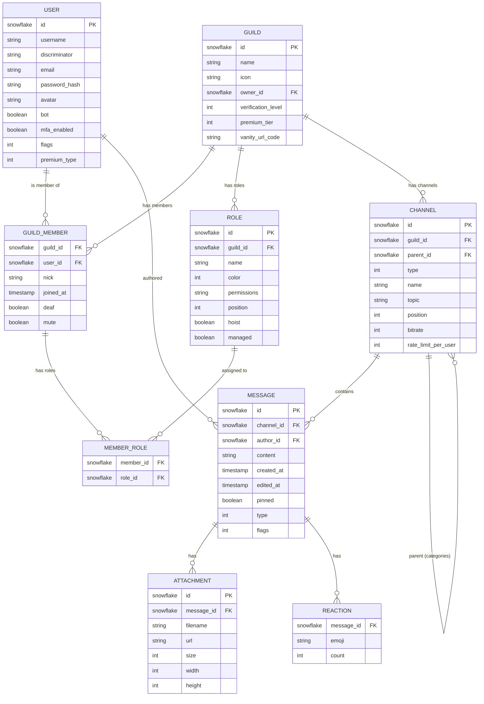

# 07 — Data Models & TypeScript Interfaces

## Snowflake IDs

All Discord entities use **Snowflake IDs** — 64-bit integers that encode:
- Timestamp (milliseconds since Discord epoch: 2015-01-01)
- Internal worker ID
- Internal process ID
- Increment counter

```typescript
type Snowflake = string; // Discord sends snowflakes as strings (bigint-safe JSON)

// Discord Epoch: January 1, 2015
const DISCORD_EPOCH = 1420070400000;

function snowflakeToDate(snowflake: Snowflake): Date {
  const id = BigInt(snowflake);
  const timestamp = Number(id >> 22n) + DISCORD_EPOCH;
  return new Date(timestamp);
}

function generateSnowflake(workerId = 0, processId = 0): Snowflake {
  const timestamp = BigInt(Date.now() - DISCORD_EPOCH);
  const sequence = BigInt(Math.floor(Math.random() * 4096));
  const id = (timestamp << 22n)
    | (BigInt(workerId) << 17n)
    | (BigInt(processId) << 12n)
    | sequence;
  return id.toString();
}
```

---

## User

```typescript
interface User {
  id: Snowflake;
  username: string;
  discriminator: string;    // "0000" - "9999" (or "0" for new username system)
  global_name: string | null; // New display name system
  avatar: string | null;    // Hash, construct URL: cdn.discordapp.com/avatars/{id}/{hash}.png
  bot?: boolean;
  system?: boolean;         // Discord official account
  mfa_enabled?: boolean;    // Only in /users/@me response
  banner?: string | null;   // Hash
  accent_color?: number | null; // Fallback if no banner
  locale?: string;          // User's chosen locale e.g. "en-US"
  verified?: boolean;       // Email verified
  email?: string | null;    // Only with email scope
  flags?: number;           // User flags bitfield
  premium_type?: PremiumType;
  public_flags?: number;    // Visible badges
}

enum PremiumType {
  None = 0,
  NitroClassic = 1,
  Nitro = 2,
  NitroBasic = 3,
}

// User flags (public_flags) - visible badges
const UserFlags = {
  STAFF:                   1 << 0,   // Discord Staff
  PARTNER:                 1 << 1,   // Partner
  HYPESQUAD:               1 << 2,   // HypeSquad Events
  BUG_HUNTER_LEVEL_1:      1 << 3,
  HYPESQUAD_BRAVERY:       1 << 6,
  HYPESQUAD_BRILLIANCE:    1 << 7,
  HYPESQUAD_BALANCE:       1 << 8,
  EARLY_SUPPORTER:         1 << 9,
  TEAM_PSEUDO_USER:        1 << 10,
  BUG_HUNTER_LEVEL_2:      1 << 14,
  VERIFIED_BOT:            1 << 16,
  EARLY_VERIFIED_BOT_DEV:  1 << 17,
  CERTIFIED_MODERATOR:     1 << 18,
  BOT_HTTP_INTERACTIONS:   1 << 19,
  ACTIVE_DEVELOPER:        1 << 22,
};

// Avatar URL construction
function getAvatarUrl(user: User, size = 128): string {
  if (!user.avatar) {
    // Default avatar based on discriminator (or ID for new system)
    const index = user.discriminator === '0'
      ? Number(BigInt(user.id) >> 22n) % 6
      : parseInt(user.discriminator) % 5;
    return `https://cdn.discordapp.com/embed/avatars/${index}.png`;
  }
  
  const ext = user.avatar.startsWith('a_') ? 'gif' : 'png'; // Animated GIF
  return `https://cdn.discordapp.com/avatars/${user.id}/${user.avatar}.${ext}?size=${size}`;
}
```

---

## Guild (Server)

```typescript
interface Guild {
  id: Snowflake;
  name: string;
  icon: string | null;
  icon_hash?: string | null;
  splash: string | null;
  discovery_splash: string | null;
  owner?: boolean;             // Only in /users/@me/guilds
  owner_id: Snowflake;
  permissions?: string;        // Only in /users/@me/guilds
  afk_channel_id: Snowflake | null;
  afk_timeout: number;         // 60, 300, 900, 1800, 3600
  widget_enabled?: boolean;
  widget_channel_id?: Snowflake | null;
  verification_level: VerificationLevel;
  default_message_notifications: DefaultMessageNotificationLevel;
  explicit_content_filter: ExplicitContentFilterLevel;
  roles: Role[];
  emojis: Emoji[];
  features: GuildFeature[];
  mfa_level: MFALevel;
  application_id: Snowflake | null; // If bot-created
  system_channel_id: Snowflake | null;
  system_channel_flags: number;
  rules_channel_id: Snowflake | null;
  max_presences?: number | null;
  max_members?: number;
  vanity_url_code: string | null;
  description: string | null;
  banner: string | null;
  premium_tier: PremiumTier;    // 0, 1, 2, 3 (server boost level)
  premium_subscription_count?: number;
  preferred_locale: string;    // e.g. "en-US"
  public_updates_channel_id: Snowflake | null;
  max_video_channel_users?: number;
  approximate_member_count?: number;
  approximate_presence_count?: number;
  welcome_screen?: WelcomeScreen;
  nsfw_level: GuildNSFWLevel;
  stickers?: Sticker[];
  premium_progress_bar_enabled: boolean;
}

enum VerificationLevel {
  None = 0,       // Unrestricted
  Low = 1,        // Must have verified email
  Medium = 2,     // Must be registered for > 5 minutes
  High = 3,       // Must be a member for > 10 minutes
  VeryHigh = 4,   // Must have verified phone
}

enum PremiumTier {
  None = 0,
  Tier1 = 1,   // 2 boosts
  Tier2 = 2,   // 7 boosts - 50MB uploads, 150kbps voice
  Tier3 = 3,   // 14 boosts - 100MB uploads, 384kbps voice, vanity URL
}

type GuildFeature =
  | 'ANIMATED_BANNER'
  | 'ANIMATED_ICON'
  | 'APPLICATION_COMMAND_PERMISSIONS_V2'
  | 'AUTO_MODERATION'
  | 'BANNER'
  | 'COMMUNITY'
  | 'CREATOR_MONETIZABLE_PROVISIONAL'
  | 'CREATOR_STORE_PAGE'
  | 'DEVELOPER_SUPPORT_SERVER'
  | 'DISCOVERABLE'
  | 'FEATURABLE'
  | 'INVITES_DISABLED'
  | 'INVITE_SPLASH'
  | 'MEMBER_VERIFICATION_GATE_ENABLED'
  | 'MORE_STICKERS'
  | 'NEWS'
  | 'PARTNERED'
  | 'PREVIEW_ENABLED'
  | 'ROLE_ICONS'
  | 'ROLE_SUBSCRIPTIONS_AVAILABLE_FOR_PURCHASE'
  | 'ROLE_SUBSCRIPTIONS_ENABLED'
  | 'TICKETED_EVENTS_ENABLED'
  | 'VANITY_URL'
  | 'VERIFIED'
  | 'VIP_REGIONS'
  | 'WELCOME_SCREEN_ENABLED';
```

---

## Channel

```typescript
interface Channel {
  id: Snowflake;
  type: ChannelType;
  guild_id?: Snowflake;             // Not present for DMs
  position?: number;
  permission_overwrites?: Overwrite[];
  name?: string | null;
  topic?: string | null;
  nsfw?: boolean;
  last_message_id?: Snowflake | null;
  bitrate?: number;                 // Voice channels: 8000-384000
  user_limit?: number;              // Voice channels: 0 = unlimited
  rate_limit_per_user?: number;     // Slowmode: 0-21600 seconds
  recipients?: User[];              // DM channels
  icon?: string | null;             // Group DM icon
  owner_id?: Snowflake;             // Group DMs
  application_id?: Snowflake;
  managed?: boolean;
  parent_id?: Snowflake | null;     // Category channel ID
  last_pin_timestamp?: string | null;
  rtc_region?: string | null;       // Voice region
  video_quality_mode?: VideoQualityMode;
  message_count?: number;
  member_count?: number;
  thread_metadata?: ThreadMetadata;
  member?: ThreadMember;
  default_auto_archive_duration?: number; // Thread default duration
  permissions?: string;             // Computed permissions (channel list response)
  flags?: number;
  total_message_sent?: number;
  default_thread_rate_limit_per_user?: number;
}

enum ChannelType {
  GuildText = 0,
  DM = 1,
  GuildVoice = 2,
  GroupDM = 3,
  GuildCategory = 4,
  GuildAnnouncement = 5,  // formerly News
  AnnouncementThread = 10,
  PublicThread = 11,
  PrivateThread = 12,
  GuildStageVoice = 13,
  GuildDirectory = 14,
  GuildForum = 15,
  GuildMedia = 16,
}

interface Overwrite {
  id: Snowflake;
  type: 0 | 1;    // 0 = role, 1 = member
  allow: string;  // Bitfield of allowed permissions
  deny: string;   // Bitfield of denied permissions
}
```

---

## Message

```typescript
interface Message {
  id: Snowflake;
  channel_id: Snowflake;
  author: User;
  content: string;          // Max 2000 chars (4000 for Nitro)
  timestamp: string;        // ISO8601
  edited_timestamp: string | null;
  tts: boolean;
  mention_everyone: boolean;
  mentions: User[];
  mention_roles: Snowflake[];
  mention_channels?: ChannelMention[];
  attachments: Attachment[];
  embeds: Embed[];
  reactions?: Reaction[];
  nonce?: number | string;  // Used for optimistic rendering
  pinned: boolean;
  webhook_id?: Snowflake;
  type: MessageType;
  activity?: MessageActivity;
  application?: Application;
  application_id?: Snowflake;
  message_reference?: MessageReference;
  flags?: number;
  referenced_message?: Message | null;
  interaction?: MessageInteraction;
  thread?: Channel;
  components?: Component[];
  sticker_items?: StickerItem[];
  stickers?: Sticker[];
  position?: number;        // Thread approximate position
  role_subscription_data?: RoleSubscriptionData;
}

enum MessageType {
  Default = 0,
  RecipientAdd = 1,
  RecipientRemove = 2,
  Call = 3,
  ChannelNameChange = 4,
  ChannelIconChange = 5,
  ChannelPinnedMessage = 6,
  UserJoin = 7,
  GuildBoost = 8,
  GuildBoostTier1 = 9,
  GuildBoostTier2 = 10,
  GuildBoostTier3 = 11,
  ChannelFollowAdd = 12,
  GuildDiscoveryDisqualified = 14,
  GuildDiscoveryRequalified = 15,
  GuildDiscoveryGracePeriodInitialWarning = 16,
  GuildDiscoveryGracePeriodFinalWarning = 17,
  ThreadCreated = 18,
  Reply = 19,
  ChatInputCommand = 20,
  ThreadStarterMessage = 21,
  GuildInviteReminder = 22,
  ContextMenuCommand = 23,
  AutoModerationAction = 24,
  RoleSubscriptionPurchase = 25,
  InteractionPremiumUpsell = 26,
  StageStart = 27,
  StageEnd = 28,
  StageSpeaker = 29,
  StageTopic = 31,
  GuildApplicationPremiumSubscription = 32,
}

const MessageFlags = {
  CROSSPOSTED:                       1 << 0,
  IS_CROSSPOST:                      1 << 1,
  SUPPRESS_EMBEDS:                   1 << 2,
  SOURCE_MESSAGE_DELETED:            1 << 3,
  URGENT:                            1 << 4,
  HAS_THREAD:                        1 << 5,
  EPHEMERAL:                         1 << 6,  // Slash command visible only to invoker
  LOADING:                           1 << 7,
  FAILED_TO_MENTION_SOME_ROLES:      1 << 8,
  SUPPRESS_NOTIFICATIONS:            1 << 12,
  IS_VOICE_MESSAGE:                  1 << 13,
};

interface Attachment {
  id: Snowflake;
  filename: string;
  description?: string;
  content_type?: string;    // MIME type
  size: number;             // File size in bytes
  url: string;              // CDN URL
  proxy_url: string;        // Proxied URL
  height?: number | null;   // If image
  width?: number | null;    // If image
  ephemeral?: boolean;
  duration_secs?: number;   // For audio attachments
  waveform?: string;        // Base64-encoded waveform for audio
  flags?: number;
}

interface Reaction {
  count: number;
  me: boolean;
  emoji: Emoji;
}

interface MessageReference {
  message_id?: Snowflake;
  channel_id?: Snowflake;
  guild_id?: Snowflake;
  fail_if_not_exists?: boolean;
}
```

---

## Role

```typescript
interface Role {
  id: Snowflake;
  name: string;
  color: number;          // Integer representation of hex color
  hoist: boolean;         // Show separately in member list
  icon?: string | null;   // Role icon hash
  unicode_emoji?: string | null;
  position: number;       // Higher = more powerful
  permissions: string;    // Bitfield (sent as string)
  managed: boolean;       // Managed by an integration
  mentionable: boolean;
  tags?: RoleTags;
  flags: number;
}

interface RoleTags {
  bot_id?: Snowflake;
  integration_id?: Snowflake;
  premium_subscriber?: null;    // Presence means it's the booster role
  subscription_listing_id?: Snowflake;
  available_for_purchase?: null;
  guild_connections?: null;
}
```

---

## Permissions

Discord permissions are stored as **64-bit integer bitfields**:

```typescript
const Permissions = {
  CREATE_INSTANT_INVITE:         1n << 0n,
  KICK_MEMBERS:                  1n << 1n,
  BAN_MEMBERS:                   1n << 2n,
  ADMINISTRATOR:                 1n << 3n,   // Bypasses all other checks
  MANAGE_CHANNELS:               1n << 4n,
  MANAGE_GUILD:                  1n << 5n,
  ADD_REACTIONS:                 1n << 6n,
  VIEW_AUDIT_LOG:                1n << 7n,
  PRIORITY_SPEAKER:              1n << 8n,
  STREAM:                        1n << 9n,
  VIEW_CHANNEL:                  1n << 10n,
  SEND_MESSAGES:                 1n << 11n,
  SEND_TTS_MESSAGES:             1n << 12n,
  MANAGE_MESSAGES:               1n << 13n,
  EMBED_LINKS:                   1n << 14n,
  ATTACH_FILES:                  1n << 15n,
  READ_MESSAGE_HISTORY:          1n << 16n,
  MENTION_EVERYONE:              1n << 17n,
  USE_EXTERNAL_EMOJIS:           1n << 18n,
  VIEW_GUILD_INSIGHTS:           1n << 19n,
  CONNECT:                       1n << 20n,
  SPEAK:                         1n << 21n,
  MUTE_MEMBERS:                  1n << 22n,
  DEAFEN_MEMBERS:                1n << 23n,
  MOVE_MEMBERS:                  1n << 24n,
  USE_VAD:                       1n << 25n,
  CHANGE_NICKNAME:               1n << 26n,
  MANAGE_NICKNAMES:              1n << 27n,
  MANAGE_ROLES:                  1n << 28n,
  MANAGE_WEBHOOKS:               1n << 29n,
  MANAGE_GUILD_EXPRESSIONS:      1n << 30n,
  USE_APPLICATION_COMMANDS:      1n << 31n,
  REQUEST_TO_SPEAK:              1n << 32n,
  MANAGE_EVENTS:                 1n << 33n,
  MANAGE_THREADS:                1n << 34n,
  CREATE_PUBLIC_THREADS:         1n << 35n,
  CREATE_PRIVATE_THREADS:        1n << 36n,
  USE_EXTERNAL_STICKERS:         1n << 37n,
  SEND_MESSAGES_IN_THREADS:      1n << 38n,
  USE_EMBEDDED_ACTIVITIES:       1n << 39n,
  MODERATE_MEMBERS:              1n << 40n,
  VIEW_CREATOR_MONETIZATION_ANALYTICS: 1n << 41n,
  USE_SOUNDBOARD:                1n << 42n,
  USE_EXTERNAL_SOUNDS:           1n << 45n,
  SEND_VOICE_MESSAGES:           1n << 46n,
};

// Permission computation
function computePermissions(
  guildRoles: Role[],
  memberRoleIds: Snowflake[],
  channelOverwrites: Overwrite[],
  memberId: Snowflake,
): bigint {
  // 1. Start with @everyone role permissions
  const everyoneRole = guildRoles.find(r => r.id === guildId);
  let permissions = BigInt(everyoneRole?.permissions ?? 0);

  // 2. Apply member's role permissions
  for (const roleId of memberRoleIds) {
    const role = guildRoles.find(r => r.id === roleId);
    if (role) permissions |= BigInt(role.permissions);
  }

  // 3. If ADMINISTRATOR, bypass all channel overwrites
  if (permissions & Permissions.ADMINISTRATOR) {
    return BigInt('0xFFFFFFFFFFFFFFFF'); // All permissions
  }

  // 4. Apply @everyone channel overwrites
  const everyoneOverwrite = channelOverwrites.find(o => o.id === guildId);
  if (everyoneOverwrite) {
    permissions &= ~BigInt(everyoneOverwrite.deny);
    permissions |= BigInt(everyoneOverwrite.allow);
  }

  // 5. Apply role-specific channel overwrites
  let roleDeny = 0n, roleAllow = 0n;
  for (const overwrite of channelOverwrites) {
    if (overwrite.type === 0 && memberRoleIds.includes(overwrite.id)) {
      roleDeny |= BigInt(overwrite.deny);
      roleAllow |= BigInt(overwrite.allow);
    }
  }
  permissions &= ~roleDeny;
  permissions |= roleAllow;

  // 6. Apply member-specific channel overwrites (highest priority)
  const memberOverwrite = channelOverwrites.find(
    o => o.type === 1 && o.id === memberId
  );
  if (memberOverwrite) {
    permissions &= ~BigInt(memberOverwrite.deny);
    permissions |= BigInt(memberOverwrite.allow);
  }

  return permissions;
}

function hasPermission(permissions: bigint, flag: bigint): boolean {
  return (permissions & flag) === flag;
}
```

---

## GuildMember

```typescript
interface GuildMember {
  user?: User;
  nick?: string | null;
  avatar?: string | null;
  roles: Snowflake[];
  joined_at: string;
  premium_since?: string | null;
  deaf: boolean;
  mute: boolean;
  flags: number;
  pending?: boolean;
  permissions?: string;
  communication_disabled_until?: string | null; // Timeout
}
```

---

## Entity Relationship Diagram


