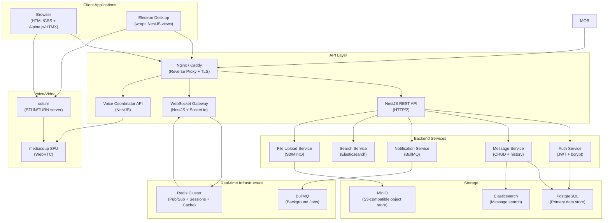

# 08 — Recommended Tech Stack for Discord Clone

## Overview

This document outlines the recommended technology stack for building a production-quality Discord clone. Each choice is justified against Discord's known stack and the specific requirements of a real-time chat platform.

---

## Full Stack Architecture

> **Decisão Arquitetural**: O projeto utiliza **NestJS como framework full-stack**, servindo tanto a API REST quanto as views do frontend via Server-Side Rendering (Handlebars). Sem React, sem framework SPA separado.



---

## Frontend Stack (NestJS SSR + Vanilla JS)

> O frontend é **servido pelo próprio NestJS** via Server-Side Rendering com Handlebars. Para interatividade leve, usamos **Alpine.js** e/ou **HTMX** sem depender de um SPA framework.

### Template Engine: Handlebars

**Por que Handlebars?**
- Integração nativa com NestJS (`@nestjs/platform-express` + `hbs`)
- Lógica mínima nos templates (sem lógica complexa no HTML)
- Partial views para reutilizar componentes (sidebar, header, etc.)
- Helpers customizáveis (formatar datas, permissões, etc.)

```typescript
// main.ts — configurar NestJS MVC
import { NestFactory } from '@nestjs/core';
import { NestExpressApplication } from '@nestjs/platform-express';
import { join } from 'path';

async function bootstrap() {
  const app = await NestFactory.create<NestExpressApplication>(AppModule);
  
  app.useStaticAssets(join(__dirname, '..', 'public'));
  app.setBaseViewsDir(join(__dirname, '..', 'views'));
  app.setViewEngine('hbs');
  
  // Registrar partials (componentes reutilizáveis)
  const hbs = require('hbs');
  hbs.registerPartials(join(__dirname, '..', 'views/partials'));
  
  await app.listen(3000);
}
bootstrap();
```

```
views/
├── layouts/
│   └── main.hbs           ← Layout base (head, scripts, body wrapper)
├── partials/
│   ├── guild-sidebar.hbs  ← Lista de servidores
│   ├── channel-list.hbs   ← Canais do servidor
│   ├── member-list.hbs    ← Lista de membros
│   ├── message.hbs        ← Item de mensagem
│   └── chat-input.hbs     ← Input de texto
├── auth/
│   ├── login.hbs
│   └── register.hbs
├── app/
│   ├── index.hbs          ← Layout principal do app
│   └── channel.hbs        ← View de um canal específico
└── errors/
    ├── 404.hbs
    └── 500.hbs
```

### Interatividade: Alpine.js

**Por que Alpine.js?**
- Reatividade declarativa no HTML (sem build step)
- < 15kB minificado + gzipped
- Perfeito para estado local (dropdown aberto, modal visível, etc.)
- Complementa o SSR do NestJS sem substituí-lo

```html
<!-- Exemplo: dropdown de emoji reaction -->
<div x-data="{ open: false, selected: null }">
  <button @click="open = !open">😀</button>
  <div x-show="open" @click.outside="open = false">
    <!-- Emoji picker -->
    <template x-for="emoji in $store.emojis">
      <button @click="addReaction(emoji); open = false" x-text="emoji"></button>
    </template>
  </div>
</div>
```

### Interatividade: HTMX (opcional, para requisições parciais)

**Por que HTMX?**
- Atualiza partes do DOM via requisições HTTP sem JS complexo
- Perfeito para: carregar mais mensagens, atualizar lista de membros
- Funciona com as rotas NestJS existentes

```html
<!-- Paginação de mensagens com HTMX -->
<div id="messages-container">
  <!-- mensagens renderizadas pelo server -->
  <div id="load-more"
       hx-get="/channels/{{ channelId }}/messages?before={{ oldestId }}"
       hx-trigger="intersect once"
       hx-swap="outerHTML"
       hx-target="#load-more">
    Loading more...
  </div>
</div>
```

### Client-Side WebSocket (Socket.io Client)

A única lib JS "pesada" necessária é o cliente do Socket.io para receber eventos em tempo real:

```javascript
// public/js/chat.js — Vanilla JS + Socket.io
const socket = io({
  auth: { token: document.cookie.match(/token=([^;]+)/)?.[1] }
});

socket.on('message:new', (message) => {
  // Renderizar a mensagem no DOM via template string
  const el = renderMessage(message);
  document.getElementById('messages-list').appendChild(el);
  el.scrollIntoView({ behavior: 'smooth' });
});

socket.on('user:typing', ({ userId, username }) => {
  document.getElementById('typing-indicator').textContent = 
    `${username} está digitando...`;
});
```

### Styling: Tailwind CSS

```bash
# Instalar no projeto
pnpm add -D tailwindcss postcss autoprefixer
npx tailwindcss init
```

```javascript
// tailwind.config.js
module.exports = {
  content: ['./views/**/*.hbs', './public/**/*.js'],
  darkMode: 'class',
  theme: {
    extend: {
      colors: {
        // Paleta de cores Discord-like
        'discord-bg':       '#313338',
        'discord-sidebar':  '#2b2d31',
        'discord-channels': '#1e1f22',
        'discord-accent':   '#5865f2',
        'discord-green':    '#23a55a',
        'discord-red':      '#f23f42',
      }
    }
  }
}
```

### Dependências Frontend (apenas o essencial)

| Lib | Tamanho | Propósito |
|-----|---------|-----------|
| `socket.io-client` | 44kB | WebSocket real-time |
| `alpine.js` | 15kB | Reatividade local |
| `htmx` | 14kB | Requisições parciais (opcional) |
| `tailwindcss` | (purgeado) | Estilização utility-first |

> **Total de JS client-side: ~73kB** — sem framework SPA, sem bundle step complexo.

---

## Backend Stack

### API Framework: NestJS (Node.js)

**Why NestJS over Express/Fastify?**
- Structured architecture (modules, controllers, services, guards)
- Built-in dependency injection
- Excellent TypeScript support
- Decorators for routing, auth guards, validation
- WebSocket support via `@nestjs/websockets`

**Why Node.js over Go/Rust?**
- Same language as frontend (TypeScript)
- Largest npm ecosystem
- Fast enough for most Discord clone use cases
- If you need raw performance later, you can migrate specific services to Go/Rust

```typescript
// NestJS app structure
src/
├── app.module.ts
├── auth/
│   ├── auth.module.ts
│   ├── auth.controller.ts
│   ├── auth.service.ts
│   ├── jwt.strategy.ts
│   └── guards/
│       └── jwt-auth.guard.ts
├── guilds/
│   ├── guilds.module.ts
│   ├── guilds.controller.ts
│   ├── guilds.service.ts
│   └── entities/
│       └── guild.entity.ts
├── channels/
├── messages/
├── users/
├── voice/
└── gateway/           ← WebSocket gateway
    ├── gateway.module.ts
    └── gateway.gateway.ts
```

### WebSocket: Socket.io

**Why Socket.io over native WebSockets?**
- Automatic reconnection with exponential backoff
- Room/namespace abstractions (perfect for guilds/channels)
- Fallback to polling for restricted networks
- Built-in horizontal scaling via `@socket.io/redis-adapter`

```typescript
// gateway.gateway.ts
import {
  WebSocketGateway,
  WebSocketServer,
  SubscribeMessage,
  OnGatewayConnection,
  OnGatewayDisconnect,
} from '@nestjs/websockets';
import { Server, Socket } from 'socket.io';
import { createAdapter } from '@socket.io/redis-adapter';

@WebSocketGateway({
  cors: { origin: process.env.FRONTEND_URL },
  transports: ['websocket', 'polling'],
})
export class GatewayGateway implements OnGatewayConnection, OnGatewayDisconnect {
  @WebSocketServer()
  server: Server;

  async handleConnection(client: Socket) {
    const user = await this.authService.validateToken(
      client.handshake.auth.token
    );
    
    if (!user) {
      client.disconnect();
      return;
    }
    
    client.data.userId = user.id;
    
    // Join rooms for all guilds the user is in
    const guilds = await this.guildService.getUserGuilds(user.id);
    for (const guild of guilds) {
      client.join(`guild:${guild.id}`);
    }
  }

  handleDisconnect(client: Socket) {
    // Update presence to offline (with delay to handle reconnects)
    this.presenceService.setOfflineDelayed(client.data.userId, 5000);
  }

  @SubscribeMessage('message:send')
  async handleMessage(client: Socket, payload: CreateMessageDto) {
    const message = await this.messageService.create(payload, client.data.userId);
    
    // Broadcast to all users in the channel's guild
    this.server
      .to(`guild:${payload.guildId}`)
      .emit('message:new', message);
    
    return message;
  }
}
```

### Database: PostgreSQL + Drizzle ORM (Local / Neon.tech / Supabase)

**Why PostgreSQL?**
- Rock-solid ACID transactions
- JSON/JSONB support for flexible fields
- Full-text search built in
- Excellent with TypeScript via Drizzle or Prisma

**Portabilidade com Neon.tech e Supabase:**
- O projeto usa PostgreSQL padrão via `DATABASE_URL` padronizada.
- **Neon.tech**: Suporta branching serverless e connection pooler (`?sslmode=require`).
- **Supabase**: Conexão direta (porta 5432) ou via PgBouncer/Supavisor (porta 6543).
- **Local (Docker)**: Postgres 16 em container para desenvolvimento offline.

**Why Drizzle over Prisma?**
- Fully type-safe SQL, no magic
- Raw SQL escape hatch when needed
- Smaller bundle, better performance
- SQL-like API (feels like writing SQL)

```typescript
// schema.ts
import { pgTable, bigint, text, timestamp, boolean, integer, varchar } from 'drizzle-orm/pg-core';

export const users = pgTable('users', {
  id: bigint('id', { mode: 'bigint' }).primaryKey(),
  username: varchar('username', { length: 32 }).notNull(),
  discriminator: varchar('discriminator', { length: 4 }).notNull().default('0'),
  email: varchar('email', { length: 255 }).unique().notNull(),
  passwordHash: varchar('password_hash', { length: 255 }).notNull(),
  avatar: varchar('avatar', { length: 255 }),
  bot: boolean('bot').notNull().default(false),
  verified: boolean('verified').notNull().default(false),
  createdAt: timestamp('created_at', { withTimezone: true }).notNull().defaultNow(),
});

export const guilds = pgTable('guilds', {
  id: bigint('id', { mode: 'bigint' }).primaryKey(),
  name: varchar('name', { length: 100 }).notNull(),
  ownerId: bigint('owner_id', { mode: 'bigint' }).references(() => users.id),
  icon: varchar('icon', { length: 255 }),
  description: text('description'),
  verificationLevel: integer('verification_level').notNull().default(0),
  createdAt: timestamp('created_at', { withTimezone: true }).notNull().defaultNow(),
});
```

---

## 🏛️ Arquitetura Hexagonal (Ports & Adapters) & Microserviços

Para garantir alta manutenibilidade, testabilidade sem banco e facilidade para desacoplar serviços em microserviços futuros:

```
[ Inbound Adapters ]             [ Application Layer ]              [ Outbound Adapters ]
- HTTP Controllers + Swagger --> [ Inbound Ports / UseCases ]
- WebSocket Gateway          --> [ Domain Entities & Rules  ]  --> [ Outbound Ports ]
- Microservice Consumers     -->                                     - UserRepositoryPort  -> Drizzle (Postgres/Neon/Supabase)
                                                                     - CachePort           -> Redis
                                                                     - MessageBrokerPort   -> Kafka/BullMQ/TCP
```

### Estrutura de Pastas por Módulo (Ex: Guilds):
```
src/modules/guilds/
├── domain/                    ← Regras puras, entidades e value objects
│   ├── entities/
│   │   ├── guild.entity.ts
│   │   └── role.entity.ts
│   └── value-objects/
│       └── snowflake-id.vo.ts
├── application/               ← Casos de uso e interfaces de portas
│   ├── ports/
│   │   ├── in/                ← Inbound Ports (Use Cases)
│   │   │   ├── create-guild.use-case.ts
│   │   │   └── list-user-guilds.use-case.ts
│   │   └── out/               ← Outbound Ports (Driven Interfaces)
│   │       ├── guild-repository.port.ts
│   │       └── guild-events-publisher.port.ts
│   └── use-cases/             ← Implementações dos Use Cases
│       ├── create-guild.service.ts
│       └── list-user-guilds.service.ts
└── infrastructure/            ← Adaptadores externos (HTTP, WS, DB)
    ├── adapters/
    │   ├── in/
    │   │   ├── controllers/   ← NestJS Controllers com Swagger
    │   │   │   ├── guilds.controller.ts
    │   │   │   └── dtos/
    │   │   │       ├── create-guild.dto.ts
    │   │   │       └── guild-response.dto.ts
    │   │   └── gateways/      ← WebSocket Gateway
    │   │       └── guilds.gateway.ts
    │   └── out/
    │       └── persistence/   ← Implementação Drizzle / Postgres
    │           ├── drizzle-guild.repository.ts
    │           └── guild.schema.ts
    └── guilds.module.ts
```

---

## 📖 Documentação de APIs com Swagger / OpenAPI

A API REST é 100% documentada através do `@nestjs/swagger` com OpenAPI 3.0:

- **Swagger UI**: `/api/docs`
- **OpenAPI JSON Spec**: `/api/docs-json`
- **Decorators nos DTOs**: `@ApiProperty()`, `@ApiPropertyOptional()`
- **Decorators nos Controllers**: `@ApiTags()`, `@ApiOperation()`, `@ApiResponse()`, `@ApiBearerAuth()`

```typescript
// Exemplo de DTO documentado com Swagger
export class CreateGuildDto {
  @ApiProperty({ example: 'Servidor dos Devs', description: 'Nome da Guild/Servidor', minLength: 2, maxLength: 100 })
  @IsString()
  @Length(2, 100)
  name: string;

  @ApiPropertyOptional({ example: 'Servidor focado em engenharia de software', description: 'Descrição da guild' })
  @IsOptional()
  @IsString()
  description?: string;
}
```

---

## 🧪 Estratégia de Testes Automatizados com Jest

O Jest é o runner oficial tanto para testes unitários quanto para testes de integração:

```
Unit Tests (*.spec.ts)         Integration Tests (*.integration.spec.ts / *.e2e-spec.ts)
-------------------------      --------------------------------------------------------
- Testa Domain & Use Cases     - Testa Controllers HTTP via Supertest
- Portas 100% mockadas         - Testa Drizzle Repository contra banco de teste
- Sem I/O de rede ou banco     - Valida WebSocket Gateway e Handshake
- Velocidade: < 20ms por teste - Valida guards, filtros e pipes do NestJS
```

**Comandos de Teste:**
```bash
npm run test            # Executa todos os testes unitários
npm run test:unit       # Executa testes unitários isolados
npm run test:integration# Executa testes de integração com banco
npm run test:cov        # Gera relatório de cobertura de código
```

### Cache: Redis

**Usage in the clone:**

| Data | TTL | Purpose |
|------|-----|---------|
| User sessions | 7 days | Auth state |
| Guild member cache | 5 min | Avoid DB hits on permission check |
| Presence data | Ephemeral | Online status |
| Rate limit counters | 1-60 min | API rate limiting |
| Socket.io pub/sub | Persistent | Multi-instance WS scaling |

```typescript
// presence.service.ts
@Injectable()
export class PresenceService {
  constructor(private redis: Redis) {}

  async setOnline(userId: string, status: 'online' | 'idle' | 'dnd') {
    await this.redis.hset(`presence:${userId}`, {
      status,
      updatedAt: Date.now(),
    });
    await this.redis.expire(`presence:${userId}`, 300); // 5 min TTL
    
    // Pub/sub: notify all gateway nodes
    await this.redis.publish('presence:update', JSON.stringify({ userId, status }));
  }

  async getPresence(userId: string) {
    return this.redis.hgetall(`presence:${userId}`);
  }
  
  async getMultiplePresences(userIds: string[]) {
    const pipeline = this.redis.pipeline();
    for (const id of userIds) {
      pipeline.hgetall(`presence:${id}`);
    }
    return pipeline.exec();
  }
}
```

### File Storage: MinIO (S3-compatible)

MinIO is an open-source S3-compatible object storage server. Run it locally or self-host on a VPS.

```typescript
// upload.service.ts
import { S3Client, PutObjectCommand } from '@aws-sdk/client-s3';
import { getSignedUrl } from '@aws-sdk/s3-request-presigner';

@Injectable()
export class UploadService {
  private s3 = new S3Client({
    endpoint: process.env.S3_ENDPOINT, // e.g., http://minio:9000
    region: 'us-east-1',              // Any value for MinIO
    credentials: {
      accessKeyId: process.env.S3_ACCESS_KEY,
      secretAccessKey: process.env.S3_SECRET_KEY,
    },
    forcePathStyle: true,             // Required for MinIO
  });

  async uploadFile(file: Express.Multer.File, path: string): Promise<string> {
    const command = new PutObjectCommand({
      Bucket: process.env.S3_BUCKET,
      Key: path,
      Body: file.buffer,
      ContentType: file.mimetype,
    });
    
    await this.s3.send(command);
    return `${process.env.CDN_URL}/${path}`;
  }

  async getPresignedUploadUrl(path: string, contentType: string): Promise<string> {
    const command = new PutObjectCommand({
      Bucket: process.env.S3_BUCKET,
      Key: path,
      ContentType: contentType,
    });
    return getSignedUrl(this.s3, command, { expiresIn: 300 });
  }
}
```

---

## Voice/Video: mediasoup

See [docs/06-voice-video.md](./06-voice-video.md) for the full voice implementation guide.

**Key packages:**
```bash
npm install mediasoup          # Server-side SFU
npm install mediasoup-client   # Client-side WebRTC
```

---

## Background Jobs: BullMQ

For async tasks like sending emails, processing uploads, notifications:

```typescript
// notification.processor.ts
@Processor('notifications')
export class NotificationProcessor {
  @Process('email')
  async handleEmail(job: Job<{ to: string; subject: string; body: string }>) {
    await this.emailService.send(job.data);
  }
  
  @Process('push-notification')
  async handlePush(job: Job<{ userId: string; title: string; body: string }>) {
    await this.pushService.send(job.data);
  }
}
```

---

## Comparison with Discord's Known Stack

| Component | Your Clone | Discord |
|-----------|-----------|---------|
| Frontend | NestJS SSR (Handlebars) + Alpine.js | React (custom build) |
| State Mgmt | Alpine.js stores + WS events | Custom Flux store |
| Styling | Tailwind CSS | Custom design system |
| Backend API | NestJS (Node.js) | Elixir + Python |
| WebSocket | Socket.io | Custom Elixir |
| Message DB | PostgreSQL | ScyllaDB (Cassandra) |
| Cache | Redis | Redis |
| Search | Elasticsearch | Elasticsearch |
| Voice | mediasoup | Custom Rust SFU |
| File Storage | MinIO/S3 | GCP Storage |
| CDN | Cloudflare / self | Cloudflare |
| Desktop | Electron (wrapping NestJS views) | Electron |
| Auth | JWT | JWT-like |
| Jobs | BullMQ | Custom |

---

## Infrastructure & DevOps

### Docker Compose (Development)

```yaml
# docker-compose.yml
version: '3.9'
services:
  postgres:
    image: postgres:16-alpine
    environment:
      POSTGRES_DB: discord_clone
      POSTGRES_USER: postgres
      POSTGRES_PASSWORD: postgres
    ports:
      - "5432:5432"
    volumes:
      - postgres_data:/var/lib/postgresql/data

  redis:
    image: redis:7-alpine
    ports:
      - "6379:6379"
    command: redis-server --appendonly yes

  minio:
    image: minio/minio
    ports:
      - "9000:9000"
      - "9001:9001"
    environment:
      MINIO_ROOT_USER: minioadmin
      MINIO_ROOT_PASSWORD: minioadmin
    command: server /data --console-address ":9001"
    volumes:
      - minio_data:/data

  elasticsearch:
    image: elasticsearch:8.14.0
    environment:
      discovery.type: single-node
      xpack.security.enabled: 'false'
    ports:
      - "9200:9200"

volumes:
  postgres_data:
  minio_data:
```

### Production: Kubernetes

For production scale:
```yaml
# Example deployment
apiVersion: apps/v1
kind: Deployment
metadata:
  name: api-server
spec:
  replicas: 3          # Horizontal scaling
  selector:
    matchLabels:
      app: api-server
  template:
    spec:
      containers:
      - name: api
        image: your-registry/discord-api:latest
        resources:
          requests:
            memory: "256Mi"
            cpu: "250m"
          limits:
            memory: "512Mi"
            cpu: "500m"
```

---

## Performance Targets

| Metric | Target | How |
|--------|--------|-----|
| API p99 latency | < 100ms | Redis caching, DB indexes |
| Message delivery | < 200ms | WebSocket push, Redis pub/sub |
| Voice latency | < 50ms | UDP, nearest SFU node |
| Gateway connections | 10,000/node | Socket.io + Redis adapter |
| Messages/sec | 1,000+ | ScyllaDB migration when needed |
| File upload | < 5s for 100MB | Direct S3 upload |
